# NORA — Software and Data Architecture

| | |
|---|---|
| **Version** | 1.0 (draft) |
| **Date** | 2026-10-25 |
| **Status** | Draft — strand `corp-db-layer` |
| **Companion** | The System Design Document (`docs/design-doc/NORA-design-doc.md`, kept outside this repository) is the executive layer. This document is the engineering layer beneath it. |

## Document outline

| Part | Content | Reader |
|---|---|---|
| I. The system in one page | The three planes, the five images, every store at rest. | Everyone. Read this first. |
| II. Processes and their interfaces | Each image and process: what it contains, what it mounts, which routes and CLIs it exposes, which env wires it. | Developers, Operations Agents. |
| III. Data design | Identity and fingerprints; every file layout and database schema with ER diagrams. | Developers who read or write a store. |
| IV. End-to-end flows | One sequence diagram per use case: ingest a release, publish, serve a question per query pattern, review enrichments, run a golden evaluation, operate two stacks. | Everyone building or debugging a flow. |
| V. Properties and boundaries | The invariants and where each is enforced; known gaps; glossary. | Architects, reviewers. |

Each part goes one level deeper than the one before it. A term is defined
where it first appears and used unchanged afterwards. Diagrams are
Mermaid; the text under each diagram says what the diagram cannot.

Conventions in this document:

- Hosts and ports are written as placeholders: `host:PORT`, `<serve-root>`,
  `<env-dir>`. No deployment value appears here.
- MNOs are written `MNO-A`, `MNO-B`; releases as `<MMMYYYY>` or `<rel>`;
  a cell (one MNO at one release) as `<mno>__<rel>`.
- "Administrator" is the person operating NORA. "Operator" is reserved for
  a mobile network operator (MNO).
- Code paths are repo-relative. CLIs are `python -m <module>`.

---

# Part I — The system in one page

## 1. Purpose and reading guide

NORA answers questions about the device requirement documents that US
MNOs publish each quarter. A question names, or implies, an MNO and a
release; NORA retrieves the relevant requirements from that cell,
enriched by a language model and corrected by domain experts, and writes a
cited answer.

This document describes how the software is organized to do that: the
processes, the data they exchange, and the stores they keep. It replaces
the per-strand design notes that accumulated while the storage layer was
built (listed in §1.1) and sits beneath the System Design Document, which
explains the product and the AI design choices. Where the two overlap,
this document is the more detailed and the more recent.

The scope is the system as built on 2026-10-25. Planned work is marked
as such and collected in §27.

### 1.1 Sources this document consolidates

| Source | What it covered | Status after this document |
|---|---|---|
| `docs/compact/strands/corp-db-layer/storage-design.md` | The storage split and the migration plan. | Superseded by Parts I and III. |
| `.../store-split-design.md`, `.../store-schema.md` | The four stores and their schemas. | Superseded by Part III §13–§16. |
| `.../publish-design.md` | The registry and the publish pipeline. | Superseded by §17 and §21. |
| `.../converter-design.md` | Flat SIRA cell to cell DB. | Superseded by §12–§13. |
| `docker/README.md` | Images, host layout, runbooks. | Stays as the runbook. Part II cites it; it does not repeat it. |
| `docs/ingestion-guide.md`, `docs/golden-eval-guide.md`, `docs/enrichment-review-guide.md` | Procedures for the three human loops. | Stay as procedures. Part IV gives the flows they implement. |
| `core/src/<module>/MODULE.md` | Per-module contracts. | Stay authoritative for signatures. This document cites them. |

### 1.2 How to read it

- To understand what runs where: §2, §4, §9.
- To change a store or read one from new code: §10, then the store's section in Part III.
- To debug a question that answered badly: §22, then §7 and §13.
- To ship a new release to a serving stack: §20, §21.
- To check that a change keeps the guarantees: §26.

## 2. The three planes

NORA is organized as three planes. Each plane has its own processes, its
own writable state, and one defined way to hand work to the next plane.

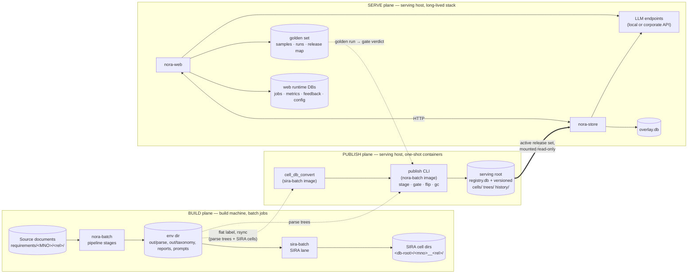

**Build plane.** Batch jobs on the build machine turn source documents
into the build artifacts: parsed requirement trees per cell, a feature
taxonomy, per-MNO prompts, and the SIRA enrichment per cell (a keyword
index plus language-model phrases per requirement). Everything the build
plane writes lives under one env dir per build and one SIRA db-root per
build. A build can be rerun or discarded without touching serving.

**Publish plane.** One-shot containers on the serving host turn build
artifacts into the four store files a stack serves (§3) and record them
in a registry. The unit of publishing is a *release set*: a label naming
one version of every store unit a stack needs. A release set is staged,
gated by a golden evaluation, then *flipped* to become the stack's active
set, in one transaction. Rollback is a flip to an earlier set. The
publish plane is the only writer of the serving root.

**Serve plane.** A stack is one nora-web and one nora-store. nora-store
loads the active release set from the registry, composes the expert
corrections (the Overlay) onto each cell at load, and answers retrieval
calls. nora-web serves the pages, keeps the per-stack runtime databases,
calls nora-store over HTTP for every piece of corpus data, and calls the
language model for the answer. The Overlay is the one store that changes
while serving; nora-store is its single writer.

Two edges cross between planes:

1. **Build → publish:** the flat label (the build's parse trees and SIRA
   cell directories) is pushed to the serving host with checksum
   verification and an atomic rename, then published from there. The
   push is `docker/serve-push.sh`; the publish is §21.
2. **Serve → publish:** a golden run against a staging nora-store
   produces the evidence for the gate; an administrator records the
   verdict in the registry. Nothing flips without it.

### 2.1 Images and hosts

NORA ships as five container images from two Dockerfiles.

| Image | Dockerfile stage | Plane | Runs as | Contains |
|---|---|---|---|---|
| `nora-batch` | `docker/nora.Dockerfile` → `nora-batch` | build, publish | one-shot job | `core/`, `customizations/`, `config/`, `sandbox/`; document extraction (docling, headless opencv); `NORA_CODE_VERSION` baked. CMD `bash`. |
| `sira-batch` | `docker/store.Dockerfile` → `sira-batch` | build, publish | one-shot job | the repo plus the patched SIRA clone at `sandbox/sira`, the `bm25x` wheel, the three SIRA prompts. CMD `bash`. |
| `nora-store` | `docker/store.Dockerfile` → `nora-store` | serve | long-lived service | same base as sira-batch; `uvicorn core.src.store_service.service:app`. |
| `nora-web` | `docker/nora.Dockerfile` → `nora-web` | serve | long-lived service | same base as nora-batch without the batch extras; `uvicorn core.src.web.app:app`; LLM roster baked from the internal repo. |
| `nora-store-test` | `docker/store.Dockerfile` → `nora-store-test` | test | one-shot | nora-store plus pytest; runs the store and converter suites. |

The build machine runs `nora-batch` and `sira-batch` as per-job
containers through `docker/cycle.sh` and `docker/ingest.sh`. The serving
host runs one compose project per stack (`STACK_NAME`), each with one
`nora-store` and one `nora-web`, and runs `nora-batch` / `sira-batch`
one-shot for publishing. Two stacks on one host can serve two release sets
side by side; §25 covers that.

Offline builds (`OFFLINE=1`) use the vendored wheels and SIRA clone under
`docker/vendor/`, so no image build or runtime step needs the internet.
The build-side `standards` stage is the one exception and is normally
skipped (§5).

## 3. Data at rest

Every persistent store, in the order the data flows. "Writer" is the only
process that creates or changes the store. "Mutable" means it changes
after it is first written; everything else is write-once and replaced by
a new file or a new version.

| # | Store | Form | Location (container view) | Writer | Readers | Mutable | Detail |
|---|---|---|---|---|---|---|---|
| 1 | Source documents | PDF, DOCX, XLSX per cell | `/data/requirements/<MNO>/<rel>/` | humans | nora-batch `extract` | no (new release = new dir) | §11 |
| 2 | Profile bindings and profiles | `profiles.json`; `customizations/profiles/*.json` (committed) | `<env-dir>/profiles.json`; image | humans | nora-batch `profile` | yes (edited per cycle) | §11 |
| 3 | Build artifacts | per-stage JSON under the env dir: `out/extract`, `out/profile`, `out/parse` (requirement trees), `out/resolve`, `out/taxonomy`, `reports/` | `<env-dir>/out/<stage>/[<MNO>/<rel>/]` | nora-batch | sira-batch adapter, trees/history builders, nora-web (dev fallback) | per build only | §11 |
| 4 | Per-MNO SIRA prompts | `doc_requirement_<MNO>_vNN.txt` | `<env-dir>/prompts/` | humans (derived with a playbook) | sira-batch | yes (new version = new file) | §12 |
| 5 | SIRA cell directories | `raw/corpus.jsonl`, `raw/fingerprints.jsonl`, `index/best` (bm25x), `runs/doc-enrich/<run>/`, `enrichments/doc/` | `<db-root>/<mno>__<rel>/` | sira-batch | converter, nora-store (flat dev mode) | per run (append-only runs) | §12 |
| 6 | Flat label | hard-linked snapshot of 3 and 5 plus `MANIFEST.json` | `serve/<label>/{nora,sira}/` | `docker/promote.sh` | converter, publish | no | §12 |
| 7 | **Cells store** | `cell-<mno>-<rel>-vN.db` (SQLite, schema 2): corpus rows, raw SIRA phrases, vanilla index blobs | `<serve-root>/cells/` | publish (via converter) | nora-store | no | §13 |
| 8 | **Trees store** | `trees-<mno>-<rel>-vN.db` (SQLite): the parsed requirement tree per cell | `<serve-root>/trees/` | publish (via `trees_build`) | nora-store; nora-web through `/stores/trees/v1` | no | §14 |
| 9 | **History store** | `history-<mno>-vN.db` (SQLite): release lineage per MNO | `<serve-root>/history/` | publish (via `history_build`) | nora-store; `/stores/history/v1` | no | §15 |
| 10 | **Registry** | `registry.db` (SQLite): store versions, release sets, gate runs, active set, flips | `<serve-root>/registry.db` | publish CLI | nora-store (read-only) | yes (append + one pointer) | §17 |
| 11 | **Overlay store** | `overlay.db` (SQLite): expert enrichment edits, labels, reason categories | `/data/corrections/overlay.db` on the authority stack | nora-store (the Overlay authority) | nora-store at load; nora-web for review; peer stack over HTTP | **yes, live** | §16 |
| 12 | Overlay JSON backup | `sira-enrich/<MNO>.json`, label and reason files | `/data/corrections/sira-enrich/` | `overlay_import` (one-time source); nora-web dev fallback | — | no (import-time backup) | §16 |
| 13 | Web runtime DBs | `nora_jobs.db`, `nora_metrics.db`, `nora_config.db` (per stack); `nora_test_feedback.db` (pooled) | `/data/web-state/`, `/data/feedback/` | nora-web | nora-web | yes | §18 |
| 14 | Golden set | `samples/gs-NNNN.json`, `runs/<run-id>/`, `release-map.json` | `/data/env/eval/golden/` (pooled) | nora-web Eval Studio; `golden_cli` | `golden_cli`, Eval Studio | yes | §18, §24 |
| 15 | Profile and taxonomy corrections | `corrections/{profile,taxonomy}.json` | `<env-dir>/corrections/` | humans | nora-batch | yes | §11 |
| 16 | Vector store (dev only) | Chroma per cell, `out/vectorstore/<MNO>/<rel>/` | `<env-dir>/out/vectorstore/` | nora-batch `vectorstore` stage | nora-web NORA lane, rerank-pin fetch | per build | §11, §22 |
| 17 | Baked into images | code, the patched SIRA clone and its query and rerank prompts, the LLM roster, `config/*.json` | image layers | image build | all | no (new image) | §4 |

Three things to take from the table:

- **The serving root (7–10) is the only thing a stack needs to answer
  questions**, plus the Overlay (11) and the language model. The env dir
  and the SIRA cell directories are build-side; a served stack does not
  mount them except for the golden set path and, in dev fallback, parse
  trees.
- **Only three stores change while serving:** the Overlay (expert edits),
  the web runtime DBs (jobs, metrics, feedback, config), and the golden
  set (new samples and runs). Everything else changes only by publishing
  a new version, and old versions stay on disk until `publish gc`.
- **One writer per store.** The registry has one writer (the publish
  CLI). The Overlay has one writer (the authority nora-store). The web
  DBs have one writer (that stack's nora-web). This is what makes a
  stack's state reproducible: the registry's `active` rows plus the
  Overlay's content say exactly what it serves.

### 3.1 What crosses the network

| Edge | Protocol | Carries | Wired by |
|---|---|---|---|
| nora-web → nora-store | HTTP | `/query` (retrieval), `/cells*` (inventory, review rows, reload), `/stores/{trees,history,overlay}/v1`, `/healthz` | `NORA_STORE_URL`, `NORA_STORE_URLS`, `NORA_{OVERLAY,TREES,HISTORY}_URL` |
| nora-store (peer) → nora-store (authority) | HTTP | `/stores/overlay/v1` reads | `NORA_OVERLAY_URL` |
| nora-store → LLM | HTTP (OpenAI-compatible) | query expansion, rerank | `NORA_LLM_SHIM_URL`, `NORA_SIRA_RERANK_LLM_URL` |
| nora-web → LLM | HTTP (OpenAI-compatible or Ollama) | answer synthesis, golden curation | roster in `config/llm.json`, `NORA_LLM_*` |
| sira-batch → LLM | HTTP | document enrichment | `NORA_SIRA_ENRICH_LLM_URL` |
| nora-batch → LLM | HTTP | taxonomy extraction | `.env.nora-batch` |
| build machine → serving host | rsync over SSH | the flat label | `docker/serve-push.sh` |
| publish CLI → nora-store | HTTP | `POST /registry/reload`, `GET /healthz` (verify after flip) | `publish flip --store-url` |

Everything else is a file read on a mounted volume. No process reads
another process's database file directly, with one exception by design:
nora-store reads `registry.db`, which the publish CLI writes, and SQLite's
rollback journal makes that safe across processes on one host.

---

# Part II — Processes and their interfaces

Part I named the planes and the stores. This part takes each image in
turn and says what is inside it, how it is started, what it mounts, and
every interface it exposes: HTTP routes for the services, CLIs for the
jobs. §9 closes with the full matrix of who talks to whom.

## 4. Images and containers

### 4.1 Build lineage

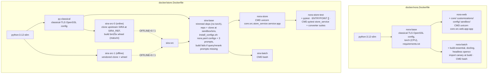

Two facts matter for operations:

- **`NORA_CODE_VERSION` is baked** into nora-web, nora-batch and
  nora-store from the `CODE_VERSION` build arg. Healthz reports it; the
  publish CLI records it in each release set. An image built from an
  uncommitted tree has an honest but useless value.
- **The SIRA clone is part of the image**, patched (per-stage routing,
  batched enrichment, extra config dir, no-best-update) and carrying the
  three prompt files (`doc`, `query`, `relevance`). nora-store falls back
  to the clone's query and rerank prompts when no run directory supplies
  them. A prompt change is therefore an image rebuild, which is intended:
  prompts are code.

Both Dockerfiles honor `HTTP_PROXY` / `HTTPS_PROXY` / `NO_PROXY` at build
time, and `OFFLINE=1` switches every network fetch to `docker/vendor/`
(filled by `docker/prep-offline.sh`; base images by
`docker/skopeo-pull-bases.sh`).

### 4.2 Compose services

One compose file, `docker/docker-compose.yml`, four services, three
profiles. The compose project name is the stack name.

| Service | Profiles | Lifetime | User | Mounts (host → container) | Env files | Fixed environment |
|---|---|---|---|---|---|---|
| **nora-store** | serve, dev | daemon, `restart: unless-stopped` | `SERVE_UID:SERVE_GID` | `STORE_ROOT` → `/data/db` (optional in registry mode); `SERVE_REGISTRY_ROOT` → `/data/serve` **ro**; `CORRECTIONS_DIR` → `/data/corrections` **rw** (Overlay authority); `NORA_ENV_DIR` → `/data/env` ro; `TREES_ROOT`, `HISTORY_ROOT` → `/data/trees`, `/data/history` ro (dev/test) | `.env.nora-store`, `.env.secrets` | `NORA_STORE_ROOT`, `NORA_STORE_CORRECTIONS_ROOT`, `NORA_ENV_DIR`; `NORA_TREES_ROOT` / `NORA_HISTORY_ROOT` / `NORA_STORE_REGISTRY` set only when the host var is set; `NORA_STORE_RELEASE_SET`; `HOME=/tmp`; `HF_HUB_OFFLINE=1` |
| **nora-web** | serve, dev | daemon | `SERVE_UID:SERVE_GID` | `NORA_ENV_DIR` → `/data/env` rw; `WEB_STATE_DIR` → `/data/web-state`; `FEEDBACK_DIR` → `/data/feedback` (pooled); `CORRECTIONS_DIR` → `/data/corrections` (dev fallback only); `GOLDEN_DIR` → `/data/env/eval/golden` (pooled, shadows the env dir) | `.env.nora-web`, `.env.secrets` | `ENV_DIR`; `NORA_{JOBS,METRICS,CONFIG}_DB` under web-state; `NORA_FEEDBACK_DB`; `NORA_CORRECTIONS_ROOT`; `NORA_STORE_URL`; `NORA_{OVERLAY,TREES,HISTORY}_URL` (interpolated from the wiring env; default this stack's nora-store) |
| **nora-batch** | ingest, dev | one-shot (`compose run --rm`) | `JOB_UID:JOB_GID` | `NORA_ENV_DIR` → `/data/env`; `REQUIREMENTS_DIR` → `/data/requirements` ro; `STORE_ROOT` → `/data/db`; `MODELS_DIR` → `/data/models` (docling artifacts); `GOLDEN_DIR` → `/data/env/eval/golden` | `.env.nora-batch`, `.env.secrets` | `ENV_DIR`, `NORA_REQUIREMENTS_DIR`, `DOCLING_ARTIFACTS`, `HF_HUB_OFFLINE=1`, `HOME=/tmp` |
| **sira-batch** | ingest, dev | one-shot | `JOB_UID:JOB_GID` | `STORE_ROOT` → `/data/db`; `NORA_ENV_DIR` → `/data/env` | `.env.sira-batch`, `.env.secrets` | `HOME=/tmp` |

Rules the file encodes:

- `environment:` holds only container paths and inter-service URLs and
  always wins over the env files, so a runtime knob file cannot break the
  container layout.
- Every service gets `host.docker.internal` → host gateway, to reach LLM
  endpoints served on the host. A container cannot reach its own stack's
  published port that way (hairpin); services address each other by
  service name.
- Volumes that are optional mount `./empty` when unset, and the matching
  `NORA_*` variable stays empty, which the store factories read as "not
  configured".
- Two kinds of env file: the **wiring env** (`.env`, from `env.example`:
  paths, ports, UIDs, image tags, stack name) read by compose, and the
  **runtime envs** (`.env.<service>`, from `env.<service>.example`) read
  by the container. Secrets go in `.env.secrets`, which every service
  loads last. §19 lists every variable.

### 4.3 Publishing containers

The publish plane has no compose service. It runs the batch images
one-shot with explicit mounts (`docker run`), because its inputs (the
flat label, the serving root) are not the stack's mounts. The runbook in
`docker/README.md` ("Registry publish") gives the commands; §21 gives
the flow. Two images are involved: `sira-batch` runs the converter
(needs the `bm25x` wheel), `nora-batch` runs `trees_build`,
`history_build` and the publish CLI (stdlib only, but it needs the
pipeline's tree reader).

## 5. nora-batch processes

Everything in nora-batch is a Python CLI. The image has no daemon.

### 5.1 The pipeline stages

`python -m core.src.pipeline.run_cli --env-dir <dir> [--lane L | --start S --end E] [--mno M --release R] [--force] [--skip-*]`

The stage list is fixed in `core/src/env/config.py` (`PIPELINE_STAGES`);
the runner executes in that order and stops at the first failure unless
`--continue-on-error`. Per-cell stages write under
`out/<stage>/<MNO>/<rel>/`; global stages write under `out/<stage>/`.

| # | Stage | Scope | Reads | Writes | Reuse rule | In current builds |
|---|---|---|---|---|---|---|
| 1 | `extract` | per cell | every supported file under `input/<MNO>/<rel>/` (or `NORA_REQUIREMENTS_DIR`); profile hints | `out/extract/<MNO>/<rel>/<stem>_ir.json` + `images/` | skipped when the IR is newer than its source | on |
| 2 | `profile` | per cell | `<env-dir>/profiles.json` bindings (or `--profile`, or `corrections/profile.json`) | `out/profile/<MNO>/<rel>/profile.json` | always; a cell with no binding fails `PIP-E003` | on |
| 3 | `parse` | per cell | the IRs; `annotations/<doc>_annotations.json` | `out/parse/<MNO>/<rel>/<doc>_tree.json`; `reports/parse_log/`, `reports/parse_summary.json` | skipped when the tree is newer than the IR **and** its `profile_fingerprint` matches | on |
| 4 | `resolve` | per cell | the cell's trees | `out/resolve/<MNO>/<rel>/<plan>_xrefs.json` | always recomputed | on |
| 5 | `standards` | global | all resolve manifests, parse trees | `out/standards/reference_index.json`, per-spec sections | — | **runs unless `--skip-standards`**; needs network, so skipped in practice |
| 6 | `taxonomy` | global | every cell's trees (newest release wins per MNO and plan); optional overview texts | `out/taxonomy/taxonomy.json`, `<plan>_features.json`, `extraction_state.json` ledger, `.corpus_fingerprint` | per-plan ledger keyed on tree sha; fail-soft per plan; `corrections/taxonomy.json` short-circuits | off by `config/llm.json` `skip_taxonomy`; run explicitly by the cycle driver |
| 7 | `graph` | global | parse, resolve, taxonomy, standards | `out/graph/knowledge_graph.json` | — | off (`skip_graph`) |
| 8 | `vectorstore` | per cell | the cell's trees | Chroma under `out/vectorstore/<MNO>/<rel>/` | always rebuilt | not run (the `nora` lane is never invoked) |
| 9 | `eval` | global | xlsx in `eval/` | `out/eval/report.json` | — | not run |

Lane aliases: `ingestion` = stages 1–5, `nora` = stages 6–9. The SIRA
lane (§6) is not a pipeline stage. The skip flags resolve CLI > env var
> `config/llm.json` > env config. Every run writes
`reports/report_<ts>.txt`.

There is no manifest for a build. The reuse rules above are the state:
file mtimes, the tree's profile fingerprint, and the taxonomy ledger.
Reuse works within one env dir; the cycle driver (§5.2) creates a new env
dir per cycle, so across cycles only taxonomy is seeded (by copying the
previous `out/taxonomy`). §20 spells out the consequence.

### 5.2 Drivers

| Script | Role |
|---|---|
| `docker/ingest.sh <MNO> <rel> [-f] [-t] [-l lane]` | One detached `compose run nora-batch` of `run_cli --lane ingestion --mno --release`. `-t` chains a taxonomy run. Console log lands in `<env-dir>/reports/`. |
| `docker/cycle.sh <verb>` | The cycle driver: `start` (new build dir, copies `profiles.json`, repoints the builds wiring env), `parse` (whole corpus, detached), `prompts` (gate: shape check, copy into `<build>/prompts/`), `taxonomy`, `enrich` (per cell, smallest first, via sira-batch), `verify-enrich` (gate), `promote`, `abandon`, `status`. One cycle at a time, held by a baton file; every phase writes a compact `CYC-*` block under `reports/`; image ids are recorded at start. |

### 5.3 Store builders

| CLI | Input | Output | Verify |
|---|---|---|---|
| `python -m core.src.stores.trees_build --env-dir D --out O [--cells M__R,…] [--force]` | `out/parse/<mno>/<rel>/*_tree.json` | one `trees-<mno>-<rel>.db` per cell, temp name then rename | SQLite store vs file store must agree on `list_docs`, every `load_tree`, every `reqs_for_plan`, ~50 sampled `find_req` |
| `python -m core.src.stores.history_build --env-dir D [--trees-root T] --out O [--mno M,…] [--force]` | the Trees store (SQLite root, else parse trees) across all of an MNO's releases | one `history-<mno>.db` per MNO | release list equals the Trees store's; self-diff of the latest release empty; requirement counts match; sampled latest versions carry the tree's `text_fp` |

Both print counts only, never requirement text, and carry error codes
`TRS-E001..E006` and `HIS-E001..E005`. The publish CLI calls both; no
cycle script does.

### 5.4 The publish CLI

`python -m core.src.stores.publish <publish | gate | flip | rollback | gc | status> --serve-root <root> …`

| Subcommand | What it does | Fails with |
|---|---|---|
| `publish --label L [--cells-src DIR \| --sira-root DIR --enrich-run NAME] [--trees-src DIR \| --env-dir DIR] [--cells U,…] [--base L\|none] [--note] [--prompt-scheme] [--work-dir] [--dry-run]` | Plans a release set: identifies every unit from its file's `meta`, reuses a live version with the same `source_fingerprint` and `schema_version`, inherits untouched units from the base set (default: the active set), rebuilds History for MNOs whose Trees changed, then stages the new files and records the set, all under one registry write lock. | `PUB-E001` label exists, `PUB-E002` unit source unusable, `PUB-E003` nothing to publish, `PUB-E007` staging failed |
| `gate --label L --kind golden-stage1\|golden-stage2\|manual --verdict pass\|fail\|waived [--run-ref ID] [--note]` | Records one gate run. | `REG-E008` bad kind or verdict |
| `flip --label L [--mode staged\|expedited\|override] [--force --reason TEXT] [--note] [--store-url URL]` | Refuses without a passing gate rule and a present file per member; `--force` records a waived manual gate; `active` := the set, one transaction; with `--store-url`, reloads the store and verifies healthz. | `PUB-E004` no passing gate, `PUB-E005` member file missing, `PUB-E008` serving verification failed |
| `rollback --to L [--force] [--note] [--store-url URL]` | A `kind=rollback`, `expedited` flip to a set that served before. | `PUB-E009` never served |
| `gc --keep N [--dry-run]` | Removes files of versions outside the protected set (active, last N sets, last N flip targets); rows stay with `removed_at`; orphan files reported, not deleted. | — |
| `status [--label L]` | Active set, versions, gates, flips as JSON. | `PUB-E010` registry unusable |

Registry errors `REG-E001..E008` surface through the same CLI. Output is
JSON of counts and identities. §17 has the schema, §21 the flow.

### 5.5 Other CLIs that run in nora-batch

| CLI | Purpose |
|---|---|
| `core.src.stores.overlay_import --corrections-root D --db P [--force]` | One-time copy of the JSON Overlay into SQLite; verifies equality per MNO inside the same transaction; prints counts. `OVL-E001..E004`. |
| `core.src.eval.golden_cli --env-dir D --stack-url U --stack-label L [--stage 1\|all] …` | The golden evaluation runner (§24). Reads samples and the release map from the golden dir; calls a stack's `/query` and `/healthz`; writes `runs/<run-id>/`. |
| `core.src.eval.golden_release_cli {show,migrate,advance,review}` | Maintains the relative-release map. |
| `core.src.eval.golden_report_cli` | Stdlib inspector of a run directory. |
| `core.src.env.env_cli` | Create, list, inspect env dirs. |
| `core.src.<module>.<module>_cli` for parser, profiler, resolver, taxonomy, standards, graph, vectorstore, profile_miner | Per-stage CLIs used for repair and review outside the runner. |

## 6. sira-batch processes

sira-batch produces the SIRA cell directories and, through the converter,
the Cells store files. It is the only build process that calls the
enrichment language model at scale.

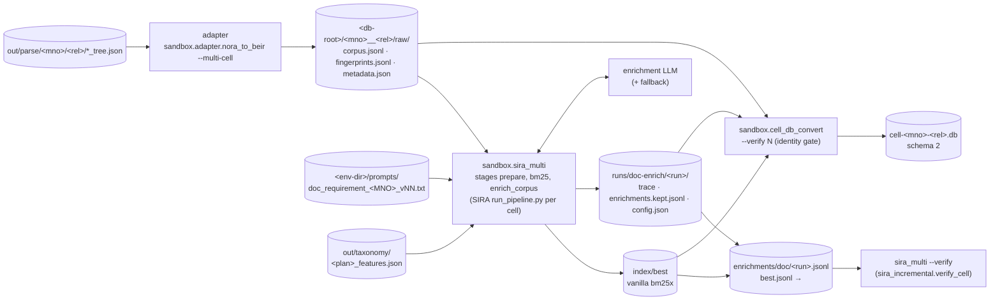

### 6.1 The lane

`python -m sandbox.sira_lane --env-dir D --db-root R --run-name NAME [--only CELL] [--wipe-stale-index] [--verify] [--index cell-db] [--heal-torn] [--retry-failed]`

Steps, in order:

1. Optional repairs on an existing run (`--heal-torn`, `--retry-failed`).
2. **Adapter.** Reads every parse tree, writes per cell `raw/corpus.jsonl`
   (one row per requirement plus `doc:` and `section:` rows for
   fan-out), `raw/fingerprints.jsonl` (`text_fp` per requirement),
   `raw/metadata.json`, empty query and qrels files, and a
   `SOURCE.json` stamp at the db-root. `--wipe-stale-index` removes
   `index/`, `enrichments/`, `eval/`, `retrieval/` and keeps `runs/`.
3. **sira_multi.** For each cell (a directory with `raw/metadata.json`):
   write a hydra data config under `.hydra-configs/`, run the SIRA
   pipeline inside the clone with `SIRA_EXTRA_CONFIG_DIR` set, stages
   `prepare`, `bm25`, `enrich_corpus`. A failing cell does not stop the
   others. `enrich_corpus` is the batched enrichment: requirements are
   packed per plan under a token budget, the plan's taxonomy block and
   the MNO's document prompt are prepended, one language-model call per
   batch, with retries, a per-batch trace, and a fallback endpoint for
   permanent refusals. Each call's outcome lands in
   `runs/doc-enrich/<run>/trace.*.jsonl`; the kept phrases in
   `enrichments.kept.jsonl`.
4. Optional **verify**: per cell, the run's kept set is checked against
   the corpus (coverage, torn batches, failures) and a compact block is
   printed.
5. Optional **`--index cell-db`**: run the converter into
   `<db-root>/cell-dbs/`, pinning the run that just completed.

The cycle driver runs step 3 per cell, smallest first, then a verify over
all cells. The default run name is the build id. `sira_incremental.py`
carries subcommands for pruning changed documents, committing and
promoting runs, dedup and healing; the lane calls only the repair ones.

### 6.2 The converter

`python -m sandbox.cell_db_convert (--label <serve>/<label> | --db-root R) --out O [--cells …] [--enrich-run NAME] [--overlay-db P | --overlay-root D] [--verify N] [--force]`

Reads per cell the raw corpus and fingerprints, `index/best`, and the
phrases of the pinned (else latest) `doc-enrich` run, falling back to
`enrichments/doc/best.jsonl`. Writes `cell-<mno>-<rel>.db` (temp, fsync,
rename) with the **vanilla** index blobs and the **raw** phrases; the
Overlay is never stored in the file. It is read only for the identity
gate: the converter composes vanilla + phrases + Overlay in memory,
reloads the vanilla index from the written blobs, composes again, and
requires identical top-k rankings and scores on N title probes
(`CNV-006` on mismatch). A `conversion-report.json` with counts and
digests sits beside the output. §13 has the schema.

## 7. nora-store

One process per stack. It owns every piece of corpus data a stack serves
and the one mutable corpus store, the Overlay. nora-web never opens a
corpus file in a served deployment.

### 7.1 Startup and load modes

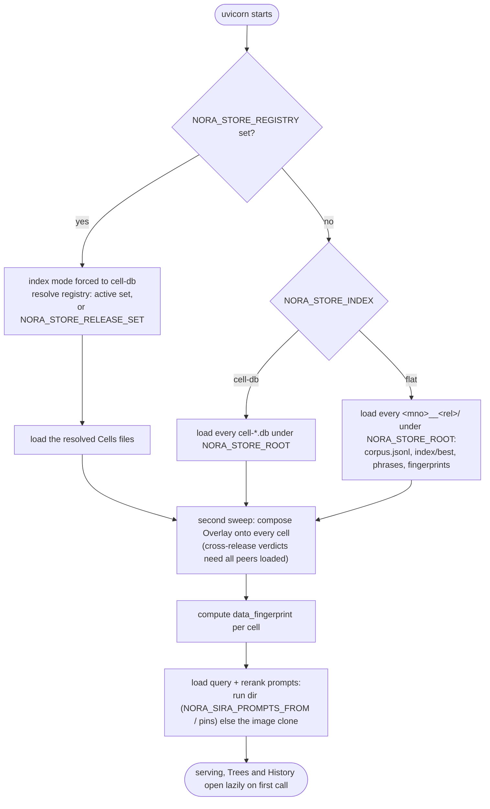

Three modes, one code path after load:

| Mode | Selected by | Cells come from | Reload | Who uses it |
|---|---|---|---|---|
| registry | `NORA_STORE_REGISTRY` (compose sets it from `SERVE_REGISTRY_ROOT`) | the registry's `active` rows, or the set named by `NORA_STORE_RELEASE_SET` (a staging store) | `POST /registry/reload` swaps only units whose file changed | every served stack |
| cell-db | `NORA_STORE_INDEX=cell-db` | every `cell-*.db` under `NORA_STORE_ROOT` | per-cell `POST /cells/{cell}/reload` | dev, converter testing |
| flat | default when neither is set | every `<mno>__<rel>/` directory under `NORA_STORE_ROOT` | per-cell reload re-reads the directory | the build machine's dev stack |

In every mode the Overlay backend is chosen the same way: `NORA_OVERLAY_URL`
(a peer, read-only), else `NORA_OVERLAY_DB` (SQLite, this store is the
authority), else `NORA_STORE_CORRECTIONS_ROOT` JSON. `_registry_resolve`
is called once per load or reload and cached, so Cells, Trees, History and
healthz all report the same set until the next reload: a flip in progress
is never visible as a mixed set.

### 7.2 Routes

| Route | Purpose | Called by |
|---|---|---|
| `POST /query` | Retrieval: scope resolution, expansion, per-cell BM25, rerank, fusion. Body `{query, top_k?, label?, text_chars?}`. Returns ranked rows with (mno, release) provenance, `resolved_cells`, `unresolved`. | nora-web Ask lanes, golden runner |
| `GET /cells?label=` | Per-cell inventory: counts, loaded_at, correction counts, `overlay_digest`. | nora-web inventory and review |
| `GET /cells/{cell}/plans?label=` | Plans of a cell with `pending_plans` (live Overlay diffed against the load snapshot). | review page |
| `GET /cells/{cell}/enrichments?plan&req_id&label` | Review rows: requirement text, index words, LLM phrases, effective set, suppressed, held, fingerprint. | review page |
| `POST /cells/{cell}/reload?label=` | Apply: rebuild the cell from its source and recompose with the live Overlay, under a per-cell lock. 409 for schema-1 cell DBs. | review Apply |
| `POST /registry/reload` | Re-resolve the registry; swap changed units; load prompts if missing. Reply: `release_set`, `changed`, `prompts_loaded`, `missing_prompts`. | publish `flip --store-url` |
| `GET /healthz` | Identity, mode, knobs, prompt provenance, store kinds (§7.3). | everyone |
| `/stores/cells/v1/*` | `GET cells`, `/{mno}/{rel}/meta`, `/rows`, `/phrases`, `/effective` over the loaded state. | tools, tests |
| `/stores/trees/v1/*` | `cells, docs, tree, plans, find, reqs, node, children, subtree, ancestors, fingerprint`. | nora-web requirement browser, `/api/req`, Eval Studio picker |
| `/stores/history/v1/*` | `mnos, releases, req, plan, req/last-changed, plan/last-changed, diff, latest, pairs`. | the release-change answer (rel-history); `pairs` carries requirement text |
| `/stores/overlay/v1/*` | reads: `mnos`, `overlay/{mno}`, `/entry`, `/version`, `/digest?label`, `labels/accepted`, `labels/disabled`, `reasons`; writes (409 unless authority): `PUT` entry and label and reason sets, `POST /edit` (one op in one transaction). | nora-web review edits; peer store reads |

The four `/stores/*` routers are generic (`core/src/stores/api.py`) and
serve each protocol method as JSON. `python -m core.src.stores.serve
--stores trees,history,overlay` hosts any subset in its own process; a
consumer follows by setting `NORA_<STORE>_URL`. No code change is needed
to split a store out, which is the design's main escape hatch for scale.

### 7.3 The healthz contract

Keys grouped by what reads them. Golden-eval's stamp and the publish
verifier are the two machine readers; everything else is for people.

| Group | Keys |
|---|---|
| Identity (machine-read) | `serve_label` (falls back to `registry_label`), `registry`, `registry_label`, `registry_release_set`, `registry_versions{store:{unit:{version,fingerprint,file}}}`, `data_fingerprint`, `data_fingerprint_cells`, `code_version`, `sira_prompt_scheme` (env override, else the served set's `prompt_scheme`, else the label manifest) |
| Health | `ok` (false when a configured prompt is missing or a load failed), `missing_prompts`, `load_error`, `cells_load_error`, `mode`, `index_mode`, `engine`, `cell_db_schema_version`, `cells` |
| Stores | `stores{overlay,trees,history: local\|http\|off}`, `overlay_authority` |
| Retrieval knobs | `max_df_ratio`, `expansion_weight`, `query_enrich_enabled`, `default_top_k`, `rerank_*`, `fusion_balanced`, `scale_topk_by_cells`, `fanout_*`, `retrieval_knobs{…, query_prompt_sha, rerank_prompt_sha}` |
| LLM | `shim_url`, `shim_model`, `shim_api_key_set` (presence only), `refusal_fallback{configured,used}`, `query_analyzer` |
| Prompts and runs | `query_prompt_loaded`, `rerank_prompt_loaded`, `*_prompt_source`, `doc_enrich_source`, `*_run_pinned`, `use_latest_runs` |

### 7.4 What nora-store calls

| Call | Endpoint | When |
|---|---|---|
| Query expansion | `NORA_LLM_SHIM_URL`, `NORA_LLM_MODEL` (OpenAI-compatible) | once per `/query` when `NORA_SIRA_QUERY_ENRICH_ENABLED` and the prompt loaded; refusal fallback to `NORA_SIRA_QUERY_FALLBACK_LLM_*` |
| Rerank | `NORA_SIRA_RERANK_LLM_URL` with backend `chat` (pointwise judge), `tei` or `openai-dedicated` (bulk) | once per `/query` over the merged pool when `NORA_SIRA_RERANK_ENABLED` |
| Overlay reads | `NORA_OVERLAY_URL` peer | at load and reload, when this store is not the authority |

## 8. nora-web

The web layer. It renders pages, keeps the per-stack runtime databases,
and calls nora-store for corpus data and the language model for answers.

### 8.1 Startup

The lifespan creates `<env-dir>/state/`, opens the jobs, metrics and
feedback databases, opens the config database when `NORA_CONFIG_DB` is
set (seeding retrieval knobs from env and pushing them into the resolver
caches), and starts the resource sampler (every 30 s). Two middlewares
wrap every request: metrics, then the team-mode gate outermost.

### 8.2 Routers

| Router | Paths | Purpose | Tier |
|---|---|---|---|
| app | `/`, `/admin-unlock?token=`, `/api/health` | dashboard; admin cookie; health with store kinds, LLM roster provenance, key presence | team: health and unlock |
| playground | `/test`, `/api/test/ask`, `/api/test/ask-stream` (SSE), `/api/test/synthesize-group`, `/api/test/feedback`, `/api/test/ingested`, `/api/test/providers/{id}/models`, `/ask/s/{row}`, `/api/ask/s/{row}`, `/ask/history`, `/api/req/{req_id}` | the Ask page and its lanes; shared answers; requirement bubble | team (merged section, SIRA lane only) |
| query | `/query`, `/api/query/ask`, `/api/query/{job}/result` | legacy query page as a background job | admin |
| enrich_review | `/enrichment-review`, `/api/enrich-review/*` | review page, edits, Apply, labels, reasons, reports | team; merge and delete admin-only |
| golden_eval | `/eval-studio`, `/api/eval-studio/*` | sample authoring, ground-truth picker, preview, curation chat, release-move review | team; delete-promoted admin-only |
| req_browser | `/req-browser/{doc}/tree`, `/req-browser/{doc}/req/{req}`, `/req-browser/compare` | requirement browser over the Trees store | admin |
| corrections | `/corrections/*` | profile and taxonomy correction editors (not the Overlay) | admin |
| parse_review, resolve_review | `/parse-review/{doc}/*`, `/resolve-review/{doc}/*` | per-document review of parse and resolve output | admin |
| pipeline, jobs, dashboard, metrics_route, files, environments, config_route | `/pipeline`, `/jobs*`, `/api/dashboard/*`, `/metrics*`, `/files*`, `/environments*`, `/config` | job submission with live logs, dashboards, file browser, env dirs, the config page | admin |

### 8.3 The team-mode gate

`NORA_WEB_TEAM_MODE=1` turns it on. Everything is admin-only except an
allowlist of prefixes: `/test`, `/api/test`, `/static`, `/api/health`,
`/admin-unlock`, `/favicon`, `/enrichment-review`, `/api/enrich-review`,
`/eval-studio`, `/api/eval-studio`, `/ask/s/`, `/api/ask/s/`,
`/ask/history`, `/api/req/`. Admin is a cookie matching
`NORA_WEB_ADMIN_TOKEN`. Gated users on the Ask page get the merged section
with lanes forced to SIRA, enforced server-side. Identity itself belongs to
the reverse proxy in front of NORA. Every new route is tested with the gate
on before it ships (the branch-flow rule in the contributor guidance).

### 8.4 Store clients

| Store | Client | Chosen by (first match wins) |
|---|---|---|
| retrieval and inventory | plain HTTP in `playground.py` | `NORA_STORE_URL` (Ask), `NORA_STORE_URLS` (review: first for reads, all for Apply), `NORA_STORE_TIMEOUT` |
| Overlay | `HttpOverlayStore` | `NORA_OVERLAY_URL` → HTTP; `NORA_OVERLAY_DB` → SQLite; `NORA_CORRECTIONS_ROOT` → JSON; none → review returns 503 |
| Trees | `HttpTreeStore` | `NORA_TREES_URL` → HTTP; `NORA_TREES_ROOT` → SQLite; else parse trees under the env dir |
| History | `HttpHistoryStore` | `NORA_HISTORY_URL` → HTTP; `NORA_HISTORY_ROOT` → SQLite; else off |

`/api/health` reports each as `local`, `http` or `off`. The local
backends are the dev fallback; compose wires all three URLs to the
stack's nora-store.

### 8.5 Language model selection

Two paths, decided by whether `config/llm.json` (or the file named by
`NORA_LLM_CONFIG`) carries a `providers` roster:

- **Roster path** (served deployments). The Ask form's `provider` id
  selects a roster entry; unknown ids fall back to `default_provider`,
  then the first entry. The entry owns model, base URL, the env var
  holding the key, timeout, and how Fast/Think maps to the endpoint
  (`reasoning_control`). The form's `model` is honored only if the
  discovery cache lists it. The roster's `fallback_provider` names the
  endpoint used once when the primary returns a permanent refusal
  (`NORA_LLM_REFUSAL_MARKERS`); the answer card says which model answered.
- **Single-provider chain** otherwise: config DB > `NORA_LLM_*` env >
  `llm.json` > env config > default; failure degrades to a mock provider.

Providers are `ollama`, `openai-compatible`, `mock`, behind one
`LLMProvider` protocol. The roster is committed in the internal
repository and baked into the image, so a roster change is a reviewed
commit.

### 8.6 Runtime state

nora-web writes four SQLite databases (jobs, metrics, feedback, config;
schemas in §18), the golden samples (§24), parse-review and
resolve-review JSON, and in dev fallback the Overlay. Caches that are not
persisted: the query pipeline, model discovery (TTL), the ingested
inventory (5 min).

## 9. Interface matrix

### 9.1 Process to process

| From | To | Transport | What | Env |
|---|---|---|---|---|
| nora-web | nora-store | HTTP | `/query`, `/cells*`, `/healthz`, `/stores/{trees,history,overlay}/v1` | `NORA_STORE_URL(S)`, `NORA_{OVERLAY,TREES,HISTORY}_URL` |
| nora-web | LLM endpoint | HTTP | synthesis, select-synth, golden curation chat, model discovery | roster or `NORA_LLM_*`; `NORA_LLM_FALLBACK_*` |
| nora-store | LLM endpoint | HTTP | expansion, rerank | `NORA_LLM_SHIM_*`, `NORA_SIRA_RERANK_LLM_*`, `NORA_SIRA_QUERY_FALLBACK_LLM_*` |
| nora-store (peer) | nora-store (authority) | HTTP | Overlay reads | `NORA_OVERLAY_URL` |
| publish CLI | nora-store | HTTP | `POST /registry/reload`, `GET /healthz` | `flip --store-url` |
| golden runner | nora-store | HTTP | `/query`, `/healthz` | `--stack-url` |
| sira-batch | LLM endpoint | HTTP | enrichment; fallback on refusal | `NORA_SIRA_ENRICH_LLM_*`, `NORA_SIRA_ENRICH_FALLBACK_LLM_*` |
| nora-batch | LLM endpoint | HTTP | taxonomy extraction | `NORA_LLM_*` in `.env.nora-batch` |
| build machine | serving host | rsync over SSH | the flat label | `docker/serve-push.sh` |

### 9.2 Process to store

| Process | Reads | Writes |
|---|---|---|
| nora-batch pipeline | source docs, profiles, env dir | env dir (`out/`, `reports/`) |
| sira-batch lane | parse trees, prompts, taxonomy | SIRA cell dirs |
| converter | SIRA cell dirs, Overlay (gate only) | cell DBs |
| trees_build, history_build | parse trees, Trees store | trees and history DBs |
| publish CLI | cell/trees/history DBs, parse trees, registry | serving root (staging, rename), registry |
| nora-store | serving root (ro), registry (ro), Overlay, prompts | Overlay (authority only) |
| nora-web | — (all corpus data over HTTP) | jobs, metrics, feedback, config DBs; golden samples; review JSON |
| golden runner | golden samples, release map | `runs/<run-id>/` |
| overlay_import | JSON Overlay | `overlay.db` (once) |

### 9.3 Error code families

| Prefix | Owner | Registered in |
|---|---|---|
| `PIP-` | pipeline runner and stages | `core/src/pipeline/error_codes.py` |
| `TRS-`, `HIS-`, `OVL-` | store builders and the Overlay import | same |
| `PUB-`, `REG-` | publish CLI, registry | same |
| `CNV-` | converter | `sandbox/cell_db_convert.py` |
| `GEV-` | golden evaluation | `core/src/eval/` |
| `CYC-`, `SFLIP-` | cycle driver, the dev/test flip script | `docker/cycle.sh`, `docker/serve-flip.sh` |

Every code carries a one-line remedy and never a fragment of document
text, so a failure can be reported in chat as is.

---

# Part III — Data design

Part II said which process owns which store. This part gives each store's
layout or schema, and first the identities that join them. Every SQLite
schema here uses TEXT, INTEGER, REAL and BLOB only, with no autoincrement
except in the web metrics table, so each is portable to Postgres without
a rewrite.

## 10. Identity and fingerprints

Three kinds of identity run through the system. Confusing them is the
most common design error, so they come first.

| Identity | Names | Example | Stable across |
|---|---|---|---|
| **Position** | MNO, release, plan, document, `req_id`, section number | `MNO-A`, `<rel>`, `REQ-A-0001` | a release: the same `req_id` may carry different text in the next release |
| **Content** | `text_fp`, `node_fp`, `subtree_fp`, `child_set_fp`, `source_fingerprint` | `v3:<sha256>` | releases, builds, hosts: equal bytes give equal hashes anywhere |
| **Version** | `-vN` file suffix, `store_version.version`, release-set label | `cell-mno-a-<rel>-v3.db` | one serving root: a counter, never compared across roots |

### 10.1 Content fingerprints (`core/src/models/fingerprint.py`)

All values are `v3:<sha256 hex>`; the prefix is the canonical-form
version, so a change to the canonical form is visible in every stored
value and never silently matched against old ones. v3 (2026-10-25)
strips Unicode format characters first; v2 counted a byte-order mark as
an edit, which made 60% of one release pair's "changed" rows noise.
After a version bump the Overlay's stored fingerprints are recomputed by
`core.src.stores.overlay_restamp` from the current trees.

| Hash | Over | Stored in | Used for |
|---|---|---|---|
| `text_fp` | canonical title + body (tables inline) | Cells `corpus.fingerprint`, Trees `node.fingerprint`, Overlay `record.fingerprint`, History `version.text_fp` | "is this the same requirement text?" The Overlay fold's first check; History's content table key; `find_by_fingerprint` |
| `node_fp` | `text_fp` + priority + applicability | History | "did this node change?" |
| `subtree_fp` | `node_fp` + one entry per child in document order: (child key, child location, child `subtree_fp`) | History | "did anything under this node change?" The diff descends only into differing subtrees |
| `child_set_fp` | the same child entries, sorted | History | equal `child_set_fp` with different `subtree_fp` = reordered |
| `source_fingerprint` | Cells: sha256 over `corpus.jsonl` + the phrase file; Trees: sha256 over the tree files' names and bytes; History: hash of its Trees inputs' fingerprints | each DB's `meta`; `store_version.fingerprint` | publish reuse: same source and same schema = same unit, no copy |

Canonical form v3: Unicode format characters removed, NFKC, quotes,
dashes and bullets unified, case folded, whitespace collapsed. The same
strip runs on every IR text block at extraction, so new trees never carry
the characters. Location is excluded, so a move is a
location change, not a content change. `text_fp` says the requirement's
own content is unchanged; it says nothing about the SIRA phrases, which
come from the corpus row in context.

### 10.2 Unit names

A **unit** is what publish versions: one cell for Cells and Trees
(`<mno>__<rel>`), one MNO for History (`<mno>`). The publish CLI reads a
unit's identity from its file's `meta`, never from the file name. File
names in a serving root are `cells/cell-<mno>-<rel>-vN.db`,
`trees/trees-<mno>-<rel>-vN.db`, `history/history-<mno>-vN.db`.

### 10.3 Labels

Three things are called a label; they are unrelated.

| Term | Means | Lives in |
|---|---|---|
| build label / release-set label | the name of one publish (`--label`), also the flat label directory the build produced | registry `release_set.label`; `serve/<label>/` |
| Overlay label | a reviewer's branch name on edit records; the view "main + label" | Overlay `record.label`, `label.accepted` |
| enrichment run name | one SIRA enrichment run in a cell (`runs/doc-enrich/<run>/`) | SIRA cell dir; Cells `meta.enrich_run` |

## 11. Build artifacts in the env dir

One env dir per build. The pipeline reads and writes only here; the SIRA
lane reads `out/parse` from here and writes to its own db-root (§12).

```
<env-dir>/
├── profiles.json                        # cell → profile binding (copied forward per cycle)
├── prompts/                             # per-MNO SIRA document prompts, doc_requirement_<MNO>_vNN.txt
├── annotations/<doc>_annotations.json   # reviewer removals applied at parse
├── corrections/{profile,taxonomy}.json  # overrides for those two stages (not the Overlay)
├── input/<MNO>/<rel>/*.pdf|docx|xlsx    # source documents, or NORA_REQUIREMENTS_DIR
├── out/
│   ├── extract/<MNO>/<rel>/<stem>_ir.json, images/
│   ├── profile/<MNO>/<rel>/profile.json
│   ├── parse/<MNO>/<rel>/<doc>_tree.json         # the requirement trees: input to SIRA, Trees, History, Eval Studio
│   ├── resolve/<MNO>/<rel>/<plan>_xrefs.json
│   ├── standards/ · graph/ · vectorstore/<MNO>/<rel>/ · eval/   # off or not run in current builds
│   └── taxonomy/taxonomy.json, <plan>_features.json, extraction_state.json, .corpus_fingerprint
├── reports/                             # parse_log/, parse_summary.json, report_<ts>.txt, lane-*.log, CYC-*.txt
├── state/                               # web DBs when the web runs against this env dir directly (dev)
└── eval/golden/                         # shadowed by the pooled GOLDEN_DIR mount in served stacks
```

A requirement tree (`<doc>_tree.json`) is the central build artifact: a
document header (plan id and name, section headers) and a `requirements`
list in document order, each requirement a dict with `req_id`, `title`,
`text`, `section_number`, `parent_req_id`, `priority`, `applicability`,
and whatever the profile extracted. Trees (§14) stores the dict verbatim;
every consumer that needs a field not yet a column reads it from there.

## 12. SIRA cell directory, flat label, and the converter's view

### 12.1 SIRA cell directory

```
<db-root>/
├── SOURCE.json                                   # env dir, git sha, adapter stamp
├── .hydra-configs/data/<cell>.yaml               # per-cell SIRA config written by sira_multi
└── <mno>__<rel>/
    ├── raw/
    │   ├── corpus.jsonl        # one row per requirement (+ doc:/section: rows); _id, title, text with context
    │   ├── fingerprints.jsonl  # _id → text_fp
    │   ├── metadata.json       # cell identity; marks the dir as a cell
    │   └── queries-test.jsonl, qrels-test.jsonl   # empty in multi-cell mode
    ├── index/best/             # the vanilla bm25x index files (serialized)
    ├── runs/doc-enrich/<run>/  # one per enrichment run: trace.kept*.jsonl, trace.failed*.jsonl,
    │                           #   enrichments.kept.jsonl ({doc_id, phrases[]}), config.json
    ├── enrichments/doc/<run>.jsonl, best.jsonl → <run>.jsonl
    ├── .incremental_hashes.json
    └── cell-dbs/cell-<mno>-<rel>.db   # only with --index cell-db
```

The vanilla index is what SIRA built from `corpus.jsonl` alone. The
phrases are raw language-model output per requirement. Nothing in the
cell directory has the Overlay applied; that happens in memory in
nora-store and in the converter's gate.

### 12.2 The flat label

`docker/promote.sh --label L` hard-links a finished build into
`serve/<label>/` and stamps `MANIFEST.json` (label, build ids, prompt
scheme, git sha) at the root and in each subdirectory:

```
serve/<label>/
├── MANIFEST.json
├── nora/out/{parse,taxonomy,graph}/   # hard links; vectorstore copied when present
└── sira/<mno>__<rel>/ … , SOURCE.json  # hard links; cell-dbs/ is NOT carried
```

`docker/serve-push.sh` moves it to the serving host (rsync, checksum
dry-run must show zero differences, atomic rename into `serve/`). The
flat label is the converter's and publish's input and the dev stack's
mount. It is not what a served stack reads.

### 12.3 What the converter reads

Per cell: `raw/corpus.jsonl`, `raw/fingerprints.jsonl`, `index/best`,
and the phrases of one run, chosen as `--enrich-run`, else the pinned
run, else the latest, else `enrichments/doc/best.jsonl`. A dangling
`best.jsonl` link fails `CNV-011`. The Overlay is read only for the
identity gate.

## 13. Cells store

One SQLite file per cell version, schema 2. Written by the converter,
staged by publish, read by nora-store at load. The index lives in this
file as serialized blobs; it is never queried through SQL, only loaded
into memory.

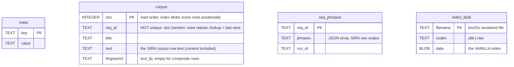

- Index: `corpus(req_id)`.
- `meta` keys: `schema_version` (2), `converter_version`, `cell_mno`,
  `cell_release`, `source_label`, `source_fingerprint`, `enrich_run`,
  `enrich_model`, `sira_docs`, `fingerprinted_docs`, `fingerprint_version`
  (empty when the label predates the fingerprint sidecar), `n_docs`,
  `bm25x_max_n`, `bm25x_ngrams`, `index_files`, `created_at`.
- **Not stored:** effective (post-Overlay) phrases, review edits, an
  enriched index. That is the whole point of schema 2: the file is a
  function of the build alone, so it is write-once and reusable, and the
  Overlay can change without a rebuild.
- Schema 1 (a baked enriched index plus an `enrichment` table) still
  loads; it cannot take review edits and reload answers 409.
- Loading: the file is opened read-only and immutable, `meta` and
  `corpus` are read, the blobs are extracted to a temp dir and the index
  loaded from them with auto-save off, then the Overlay is composed in
  (§16.3) and `bm25.enrich_batch` pushes the effective phrases into the
  in-memory index. Engine `bm25x` (default) or `fts5` by
  `NORA_STORE_ENGINE`.

## 14. Trees store

One SQLite file per cell version, schema 1. Built from the parse trees;
exact round-trip of the tree JSON plus query columns for the ten
protocol methods.

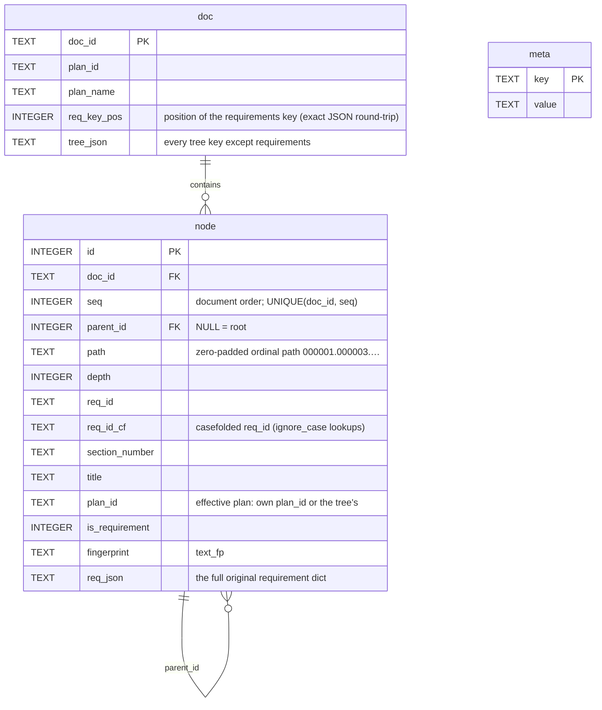

- Indexes: `req_id`, `req_id_cf`, `fingerprint`, `plan_id`,
  `(doc_id, path)`, `parent_id`.
- **Hierarchy rule** (`tree_layout`, shared by the file and SQLite
  backends): per document, by `parent_req_id`. A node whose parent id is
  not in the document is a root. For an id repeated in one document the
  last occurrence is the addressable node; earlier copies and blank-id
  nodes are isolated roots. A parent cycle is cut at its first node in
  document order.
- `path` is a 6-digit zero-padded ordinal path: subtree = range scan
  `[path + '.', path + '/')`, ancestors = path prefixes. No recursive
  query is needed.
- `meta` keys: `schema_version` (1), `fingerprint_version`, `mno`,
  `release`, `cell`, `n_docs`, `n_nodes`, `source_fingerprint`,
  `created_at`.
- **A new parse-tree field needs no schema change:** it rides in
  `req_json` or `tree_json`. A field becomes a column only when queried
  or indexed.
- Backends: `SqliteTreeStore` (a directory of files, or the explicit list
  the registry resolves), `FileTreeStore` (the parse trees under the env
  dir, dev fallback), `HttpTreeStore`. All three return equal results for
  every method; the builder's verify step proves it per file.

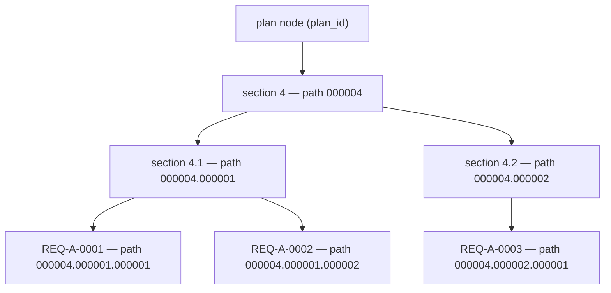

## 15. History store

One SQLite file per MNO version, schema 1. Built from the Trees store
across all of the MNO's releases, oldest first. Derived data: rebuilt
whenever an MNO's Trees changed, never edited.

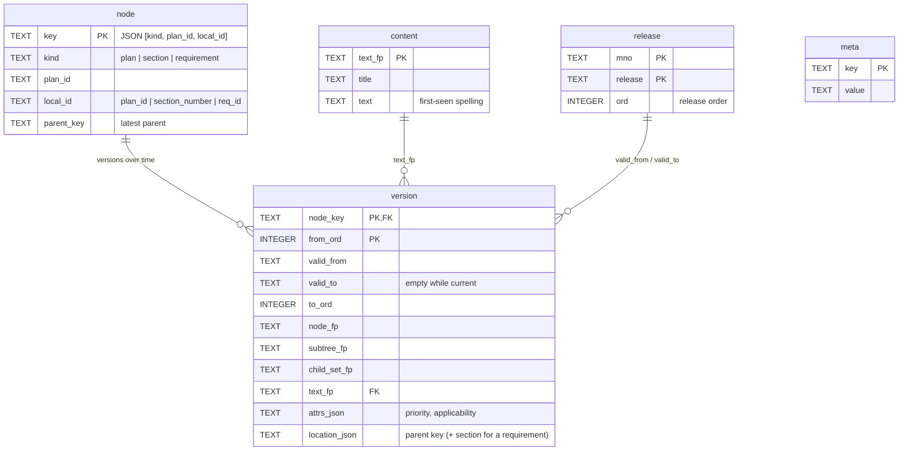

- Indexes: unique `(kind, plan_id, local_id)`, `plan_id`, `(to_ord, from_ord)`.
- **Identity across releases:** plan → `plan_id`; section →
  `(plan_id, section_number)`; requirement → `(plan_id, req_id)` with
  the effective plan, its section kept as location. A renumbered section
  is removed + added (tagged *likely renamed* when its `text_fp` matches
  a removed key in the same step); a requirement that moves keeps its key
  and records a new location.
- **A `version` row exists only when something changed:** a new
  `node_fp`, `subtree_fp` or location. `valid_to` is the last release
  that held the version, empty while held in the latest release. Absence
  closes the interval; reappearance opens a new one. Text is stored once
  per `text_fp`; a whitespace-only edit keeps the earlier display text.
- Change kinds between two releases: `added`, `removed`, `changed`
  (`node_fp`), `moved` (a different parent), `renumbered` (same parent
  and a changed outline number, or a parent that was itself renumbered;
  detail `chapter`, `sibling`, `parent` or `other`), `reordered`
  (`child_set_fp` equal, `subtree_fp` different), `likely_renamed`
  (annotation on an added and removed pair; both still count). A plan
  node added or removed means the plan is absent from one release; the
  summary lists it under `absent_plans` and keeps its rows out of
  `edits`.
- The query kinds: `changed_pairs` (the release-change payload for
  synthesis: per plan the changed requirement pairs with old and new
  text, added, removed, renamed, renumbered and moved lists, absent
  plans), `req_history`, `plan_history`, `last_changed`,
  `plan_last_changed`, `diff_releases` (kind tallies and row counts per
  plan and per containing section — the nearest real section node, else a
  two-level outline prefix — the ten most changed sections by edit rows,
  change rows with optional word diffs; kinds can overlap on one row, so
  `rows` and `renamed_pairs` are reported beside the tallies),
  `latest_changes`. Release bounds default to oldest → latest; an
  unknown label raises `ValueError` (400 over HTTP).

How intervals read, for one requirement across four releases:

| Row | `valid_from` | `valid_to` | `node_fp` | location | Why a new row |
|---|---|---|---|---|---|
| 1 | REL-1 | REL-2 | a | section 4.1 | first seen |
| 2 | REL-3 | REL-3 | b | section 4.1 | text changed |
| 3 | REL-4 | (current) | b | section 4.2 | moved |

Three rows, not four: REL-1 and REL-2 share row 1. `last_changed` =
REL-3, the last release that brought a new `node_fp`; the move at REL-4
is a location change and does not count.

The diff descends only where `subtree_fp` differs:

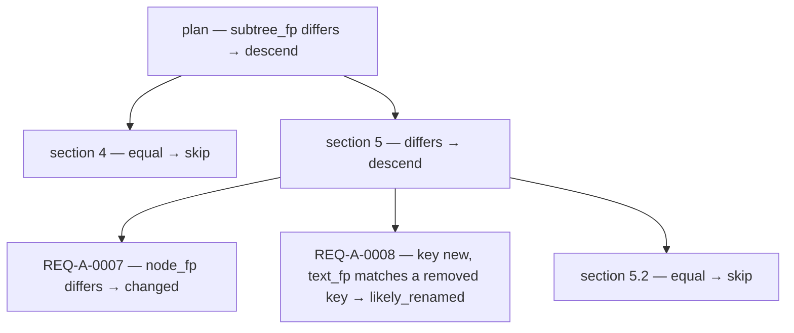

Child entries fold in key and location, not only the children's
`subtree_fp`, otherwise a renumbering, a rename with identical content or
a move under the same parent would leave every ancestor equal and the
descent would miss it.

## 16. Overlay store

The expert corrections to SIRA enrichment: per requirement, words removed
from the phrase set, words added, or the whole set suppressed. One per
deployment, outside the registry; the only corpus store that changes
while serving.

### 16.1 Backends

| Backend | Location | Role |
|---|---|---|
| `SqliteOverlayStore` | `<corrections>/overlay.db` (`NORA_OVERLAY_DB`) | the deployment backend; opened read-write by the authority nora-store |
| `JsonOverlayStore` | `<corrections>/sira-enrich/{<MNO>.json, accepted-labels.json, labels.json, reason-categories.json}` | the original layout: `overlay_import`'s source, kept as the import-time backup; nora-web's dev fallback |
| `HttpOverlayStore` | `NORA_OVERLAY_URL` | nora-web's edit client; a peer nora-store's read client |

Both local backends return byte-identical entries under `json.dumps`, so
the view digest does not depend on the backend, and `overlay_import`
verifies equality per MNO inside one transaction before committing.

### 16.2 Schema

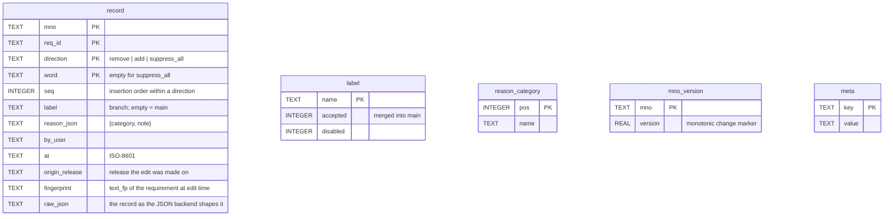

- One active record per (requirement, direction, word): re-editing a
  word replaces its record and moves it to the end (`seq`). Undo ops
  delete the record. `suppress_all` is an entry-level record with an
  empty word.
- Record shape as every consumer sees it: `{word, label, reason:
  {category, note}, by, at, origin: {release}, fingerprint?}`, plus
  `value: true` on `suppress_all`. A record the columns cannot reproduce
  exactly is kept verbatim in `raw_json`; nothing is normalized silently.
- Transactions: WAL, `busy_timeout`, `BEGIN IMMEDIATE`, per-call
  connections, one writer process. `mno_version` is a wall-clock marker
  forced strictly increasing; readers use it to detect change cheaply.
- Reads never create or migrate the file; a missing file reads as empty.
  An unknown `schema_version` raises `OVL-E005`.

### 16.3 Edit semantics and the fold

Edit ops (`core/src/stores/overlay_ops.py`, stdlib, run by the authority
inside its transaction and by nora-web's dev fallback, so the two paths
cannot drift): `remove`, `unremove`, `add`, `unadd`, `suppress`,
`unsuppress`, `reaffirm`, `discard`; store ops `set_label_merged`,
`set_label_disabled`, `delete_label`, `add_reason_category`. Ops that
create records must carry a label. Before an edit, nora-web fetches the
requirement's current `fingerprint` from nora-store and stamps it on the
record.

**Label view.** A view is "main + label": records with an empty label,
records whose label is `accepted`, and records with the view's own label.
Merging a label sets `accepted` and rewrites nothing, so provenance
survives. The disabled flag is stored and reported but not applied by the
fold.

**The fold** (`core/src/store_service/enrich_overlay.py`), per requirement at cell
load and reload:

1. Verdict per record, first match wins: record `fingerprint` equals the
   requirement's current `text_fp` → applies; else `origin_release` equals
   the cell's release → applies; else token-set Jaccard ≥ 0.85 between
   the origin release's vanilla index tokens and the current ones →
   applies; else **held** (shown to the reviewer for reaffirm or
   discard). A record with no origin applies unconditionally.
2. Effective set = `suppress_all` ? applied adds : (SIRA phrases − applied
   removes) + applied adds. Remove wins over add unless the add's `at` is
   strictly newer.
3. `bm25.enrich_batch(effective)` on the in-memory index.

**The digest.** `view_digest` = sha256 of the filtered view with sorted
keys, computed by the authority (`/overlay/{mno}/digest?label=`) and
reported by nora-store per cell as `overlay_digest` for the view it
loaded. nora-web compares the two to show "pending" and to drive
Apply-all. The merge log is outside the formula.

## 17. Registry

One SQLite file at the top of each serving root. Written only by the
publish CLI, read by nora-store at load and on reload. The registry's
`active` rows are the single pointer that says what a stack serves.

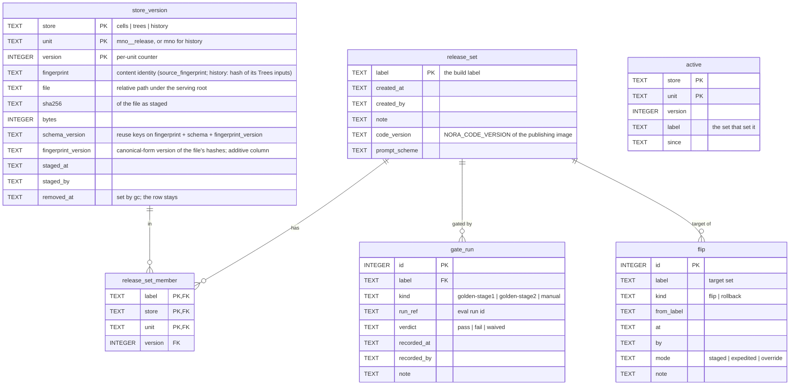

Rules:

- **Reuse:** `find_version(store, unit, fingerprint, schema_version,
  fingerprint_version)` returns the newest live version with the same
  content, schema and canonical-form version. The same source converted
  by a newer schema, or hashed under a newer canonical form, serves as
  new content; after a canonical-form bump every unit republishes once. History
  keys on a hash of its Trees inputs, so the reuse decision is made
  before any build.
- **Completeness:** a release set names every unit the stack serves.
  Units a publish did not rebuild are inherited from the base set, so
  `active` can be replaced wholesale by every flip and a rollback is the
  previous set, nothing else.
- **Gate rule:** for each gate kind the latest run decides; the set may
  flip when at least one kind passed or was waived and no kind's latest
  run failed. `--force --reason` records a `manual / waived` run rather
  than bypassing the log.
- **Flip and rollback** are one transaction each: delete `active`, insert
  the set's members, insert one `flip` row. `active_label` is empty when
  rows disagree, which can only be observed if the transaction is read
  mid-way, which SQLite's locking prevents.
- **Locking:** the publisher holds `BEGIN IMMEDIATE` across staging, so
  the version numbers it assigns and names files by stay its own.
  Readers open `mode=ro` and are never blocked; rollback journal, no WAL,
  because the root may be a network mount in a later deployment.
- **GC:** protected = the active set's label, the last N release sets by
  creation, the last N flip targets. Files of live versions outside the
  protected sets are deleted and their rows get `removed_at`. Rows are
  never deleted; a later publish of the same content gets a fresh
  version. Files no row knows about are reported, not deleted.
- `meta.schema_version` (1); an unsupported one is refused (`REG-E003`),
  never migrated in place.

## 18. Web runtime databases and the golden set

Per stack unless marked pooled. All written by nora-web.

| DB | Env var | Table(s) | Columns |
|---|---|---|---|
| jobs | `NORA_JOBS_DB` | `jobs` | `id PK, job_type, status, submitted_by, created_at, started_at, completed_at, environment, stages (JSON), current_stage, query_text, progress, result_summary, error_message` |
| | | `job_logs` | `job_id, line_number, timestamp, message` |
| metrics | `NORA_METRICS_DB` | `metrics` | `id AUTOINCREMENT, timestamp, category, name, value REAL, unit, tags (JSON)`; written by the request middleware, the resource sampler (cpu, ram, disk, gpu every 30 s) and the legacy query job (LLM latency, tokens) |
| feedback (**pooled**) | `NORA_FEEDBACK_DB` | `test_feedback` | `id, timestamp, section, question, answer, citations_json, vote, free_form_feedback, query_elapsed_ms, llm_model, metadata_json, lane, user_name, retrieved_ids, reranked_ids, cited_ids, user_score, user_categories, lane_config`; one row per question × lane on every Ask; shared links and history replay these rows |
| config | `NORA_CONFIG_DB` (opt-in) | `config_kv` | `module, key, value, updated_at, updated_by; PK(module, key)`; written by the config page and the startup seed; overrides env for LLM and retrieval knobs on the single-provider path |

The feedback database holds question and answer text, so it is the one
web database that contains proprietary content. It is pooled across
stacks on purpose: an A/B comparison needs both stacks' answers in one
place.

### 18.1 Golden set (pooled, on disk)

```
<golden-dir>/                        # GOLDEN_DIR, mounted at /data/env/eval/golden in nora-web and nora-batch
├── samples/gs-NNNN.json             # one per sample, sequential ids allocated from the files present
├── runs/<run-id>/report.json        # full per-sample detail (proprietary)
├── runs/<run-id>/report.txt         # the GEV compact block
├── release-map.json                 # {version, updated_at, updated_by, mnos: {MNO: [oldest … N]}}
├── release-map.history.jsonl
└── snapshots/<campaign>/            # optional
```

Sample shape: `{sample_id, query, area, kind: standard | version, mno,
created_by, created_at, updated_at, ground_truth: [{req_id, mno, release,
plan, source: picker | direct | retrieval}], golden_response, golden_meta:
{chat_turns, model, curated_at, edited, review?}, status: draft |
stage1-ready | golden-ready}`. `plan` is authoring metadata and is never
matched. A `version` sample may name releases relatively (`N`, `N-1`),
resolved through the release map at run time; a `standard` sample
ignores release. Writes are atomic and validated; one malformed file
aborts the whole load (`GEV-E001`).

## 19. Configuration reference

Variables grouped by the process that reads them. The example files under
`docker/` carry every variable with a comment; this table lists the ones
that change what the system does, not tuning knobs.

### 19.1 Wiring env (`docker/.env`, read by compose)

| Variable | Meaning |
|---|---|
| `STACK_NAME` | compose project; the stack's name in metrics and baselines |
| `NORA_ENV_DIR` | the build or label env dir mounted at `/data/env` |
| `SERVE_REGISTRY_ROOT` | the serving root; sets registry mode on nora-store |
| `SERVE_RELEASE_SET` | a staged set for a staging store |
| `CORRECTIONS_DIR` | holds `overlay.db` and the JSON backup |
| `WEB_STATE_DIR`, `FEEDBACK_DIR`, `GOLDEN_DIR` | web DBs; pooled feedback; pooled golden set |
| `STORE_ROOT`, `TREES_ROOT`, `HISTORY_ROOT` | dev/test only: flat cells or cell DBs; pre-built Trees and History directories |
| `REQUIREMENTS_DIR`, `MODELS_DIR` | build inputs; docling artifacts |
| `NORA_OVERLAY_URL`, `NORA_TREES_URL`, `NORA_HISTORY_URL` | nora-web's store clients; default this stack's nora-store; another stack's nora-store to share its Overlay |
| `STORE_PORT`, `NORA_WEB_PORT`, `SERVE_UID`, `SERVE_GID`, `JOB_UID`, `JOB_GID`, `IMAGE_PREFIX`, `IMAGE_TAG`, `OFFLINE`, `SIRA_REF`, `*_ENV_FILE` | ports, users, images, env-file names |

### 19.2 nora-store (`.env.nora-store`)

| Variable | Meaning |
|---|---|
| `NORA_STORE_REGISTRY`, `NORA_STORE_RELEASE_SET` | set by compose from the wiring env; registry mode |
| `NORA_STORE_INDEX` (`flat` \| `cell-db`), `NORA_STORE_ENGINE` (`bm25x` \| `fts5`) | load mode without a registry; search engine |
| `NORA_OVERLAY_DB` \| `NORA_OVERLAY_URL` | this store is the authority \| reads a peer |
| `NORA_TREES_ROOT`, `NORA_HISTORY_ROOT` | explicit directories, win over the registry (dev/test) |
| `NORA_LLM_SHIM_URL`, `NORA_LLM_MODEL`, `NORA_LLM_SHIM_API_KEY` | the expansion endpoint |
| `NORA_SIRA_QUERY_ENRICH_ENABLED`, `NORA_SIRA_EXPANSION_WEIGHT`, `NORA_SIRA_MAX_DF_RATIO`, `NORA_SIRA_TOP_K` | expansion on/off and weight; DF cut; default top-k |
| `NORA_SIRA_RERANK_ENABLED`, `NORA_SIRA_RERANK_BACKEND`, `NORA_SIRA_RERANK_LLM_*`, `NORA_SIRA_RERANK_TOP_N` | rerank on/off, backend (`chat` \| `tei` \| `openai-dedicated`), endpoint, pool size |
| `NORA_SIRA_FUSION_BALANCED`, `NORA_SIRA_SCALE_TOPK_BY_CELLS` | multi-cell fusion: round-robin across cells; top-k × cells |
| `NORA_SIRA_QUERY_FALLBACK_LLM_*`, `NORA_LLM_REFUSAL_MARKERS` | refusal fallback for expansion |
| `NORA_SIRA_PROMPTS_FROM`, `NORA_SIRA_QUERY_ENRICH_RUN`, `NORA_SIRA_RERANK_RUN`, `NORA_SIRA_USE_LATEST_RUNS` | where the serving prompts come from (a run dir); unset = the image clone |
| `NORA_SIRA_DOC_ENRICH_RUN`, `NORA_SIRA_ENRICH_MODEL_NAME` | flat mode: which enrichment run; reported model name |
| `NORA_QUERY_ANALYZER`, `NORA_DECISION_*` | scope analyzer arm (`rules` \| `llm` \| `decision` \| `confidence-routed`) |
| `SIRA_PROMPT_SCHEME` | overrides the reported prompt scheme |

### 19.3 nora-web (`.env.nora-web`)

| Variable | Meaning |
|---|---|
| `NORA_STORE_URL`, `NORA_STORE_URLS`, `NORA_STORE_TIMEOUT` | retrieval target; review read and Apply targets |
| `NORA_WEB_TEAM_MODE`, `NORA_WEB_ADMIN_TOKEN`, `NORA_WEB_ROOT_PATH` | the gate; admin cookie; reverse-proxy prefix |
| `NORA_LLM_CONFIG` | the roster file (internal repo) |
| `NORA_LLM_PROVIDER`, `NORA_LLM_BASE_URL`, `NORA_LLM_MODEL`, `NORA_LLM_API_KEY`, `NORA_LLM_TIMEOUT` | single-provider path |
| `NORA_LLM_FALLBACK_*`, `NORA_LLM_REFUSAL_MARKERS`, `NORA_LLM_REASONING_SENTINEL` | refusal fallback; final-answer marker for reasoning models |
| `NORA_SIRA_SYNTH_MODE` (`rerank-pin` \| `select-synth`), `NORA_SIRA_SYNTH_TOKEN_BUDGET` | which SIRA lane variant the Ask page runs |
| `NORA_SIRA_PIN_MIN_SCORE`, `NORA_SIRA_PIN_REL_THRESHOLD`, `NORA_SIRA_PIN_MODE`, `NORA_SIRA_PIN_MAX` | the pin filter in rerank-pin mode |
| `NORA_QUERY_ANALYZER`, `NORA_DECISION_*`, `NORA_MAX_DISTANCE_THRESHOLD`, `NORA_RERANKER_*`, `NORA_EMBEDDING_*` | the NORA lane (needs the vector store) |
| `NORA_{JOBS,METRICS,CONFIG,FEEDBACK}_DB`, `NORA_CORRECTIONS_ROOT`, `ENV_DIR` | set by compose |

### 19.4 Batch images

| Variable | Image | Meaning |
|---|---|---|
| `NORA_LLM_*`, `NORA_LLM_FALLBACK_*`, `NORA_EMBEDDING_*`, `NORA_TAXONOMY_OVERVIEW_DIR`, `DOCLING_OCR` | nora-batch | taxonomy LLM; optional corpus overview texts; OCR |
| `NORA_SIRA_ENRICH_LLM_URL/MODEL`, `NORA_SIRA_ENRICH_FALLBACK_LLM_*`, `NORA_SIRA_RERANK_LLM_*` | sira-batch | enrichment endpoint and fallback |
| `NORA_SIRA_DOC_PROMPT_DIR`, `NORA_SIRA_TAXONOMY_DIR` | sira-batch | per-MNO document prompts; per-plan taxonomy blocks |
| `NORA_SIRA_BATCH_*` | sira-batch | batch packing: prompt cap, context tokens, response tokens per requirement, chars per token, retries, concurrency, max requirements per batch (1 = single-request mode), reasoning sentinel |
| `NORA_SIRA_SKIP_UPDATE_BEST` | sira-batch | do not move `best.jsonl` |
| `NORA_CODE_VERSION` | all | baked at image build; recorded by publish |

---

# Part IV — End-to-end flows

Each section is one use case: a sequence diagram, the steps in words,
and the artifacts each step touches. The participants are the processes
of Part II and the stores of Part III; nothing new is introduced here.

## 20. Ingesting a new release of one MNO

The cycle driver runs the build plane one phase at a time, with a human
gate after prompts and after enrichment. The result is a flat label on
the serving host, ready for §21.

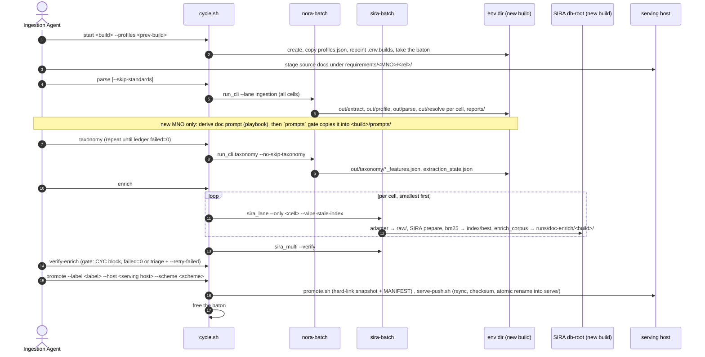

What each phase reuses, as built:

| Phase | Reused from the previous cycle | Redone |
|---|---|---|
| parse | nothing: `start` creates an empty env dir and `parse` runs every cell | every cell is extracted and parsed again |
| taxonomy | `out/taxonomy` may be copied in by hand; the ledger then keeps every plan whose tree sha is unchanged | plans of the new release, and any plan the newest release now supersedes |
| enrich | nothing: the SIRA db-root is per build | every cell is enriched again |
| publish (§21) | every unit whose `source_fingerprint` and schema match a live version, by content, regardless of build | only cells whose corpus or phrases changed; History for MNOs whose Trees changed |

So today the build plane is a full rebuild per cycle and the publish plane
is where reuse happens. For a release that adds one cell, that is
expensive but correct: unchanged cells produce byte-identical corpus and
phrases only if the enrichment is deterministic, which a language model
is not, so a re-enriched unchanged cell publishes as a new version with a
new fingerprint. §27 lists the two steps that would make the build
incremental (seed `out/parse` and the SIRA cells from the previous
build, and run the lane with `--only` the new cell).

Artifacts after the flow: the build's env dir and db-root on the build
machine; `serve/<label>/` on both hosts; nothing in any serving root yet.

## 21. Publishing a release set

Turns a flat label into versioned store files and makes a stack serve
them. Every step is a `publish` subcommand run in a one-shot container on
the serving host, against one serving root. The registry state after each
step is what a reader should remember.

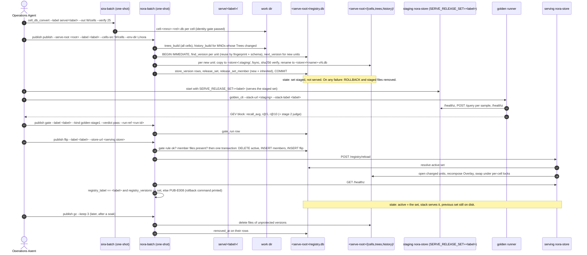

Step by step:

1. **Convert.** The converter reads the flat label's SIRA cells and
   writes schema-2 cell DBs into a work directory. `--verify 25` runs
   the identity gate. Alternatively `publish --sira-root` runs the
   converter itself.
2. **Plan.** `publish publish` scans the cell DBs and the parse trees,
   reads each unit's `meta`, and builds the plan: reuse where
   `find_version` finds the same fingerprint and schema, build otherwise.
   Trees are built for every cell; History is rebuilt only for MNOs whose
   Trees members changed. The base set (default: the active set)
   supplies every unit the plan did not touch, so the set is complete.
   Plan warnings name a Trees unit without a Cells unit and the reverse.
   `--dry-run` stops here.
3. **Stage.** Under the registry write lock, every new file is copied
   into `<store>/.staging/`, fsynced, hashed, verified against the
   source, and renamed into place as `-vN`. Rename is atomic, so a file
   is either absent or complete. Then one transaction records the
   `store_version` rows, the `release_set` row (with `code_version` from
   the publishing image and `prompt_scheme`) and the members. A failure
   anywhere rolls the transaction back and removes the staged files.
   **State: a set exists in the registry and on disk; no one serves it.**
4. **Gate.** A staging nora-store started with
   `SERVE_RELEASE_SET=<label>` serves the staged set from the same root.
   The golden runner (§24) scores it. The Operations Agent compares the
   block with the stack's baseline and records the verdict with
   `publish gate`; `run_ref` is the golden run id. The gate does not run
   the evaluation; it records it. **State: a `gate_run` row.**
5. **Flip.** `publish flip` refuses unless the gate rule holds (latest
   run per kind; all pass or waived; at least one) and every member file
   exists. Then, in one transaction, `active` becomes exactly the set's
   members and a `flip` row records label, previous label, mode and who.
   `--force --reason` records a waived manual gate first and flips in
   `override` mode. **State: `active` = the set.**
6. **Verify.** With `--store-url`, the CLI posts `/registry/reload` to the
   serving store, which re-resolves the registry, opens only the units
   whose file changed, recomposes the Overlay onto them and swaps them in
   under per-cell locks; Trees and History reopen lazily. The CLI then
   reads `/healthz` and requires `registry_label` and every unit's
   version to match the registry. A mismatch exits with `PUB-E008` and
   prints the rollback command. The registry already points at the new
   set, by design: the fix is a rollback, not a second truth.
7. **Rollback** is `publish rollback --to <previous label>`: the same
   transaction with `kind=rollback`, allowed only to a set that served
   before, with the same optional reload and verify.
8. **GC.** `publish gc --keep N` deletes the files of versions outside
   the protected sets (active, last N sets, last N flip targets) and
   marks their rows `removed_at`. Rows stay, so every set, gate and flip
   remains readable as provenance. Orphan files are reported, not
   deleted.

Artifacts after the flow: `<serve-root>/registry.db` with the new set
active; new `-vN` files only for changed units; the staging store can be
stopped; the flat label stays as the converter's input for the next
cycle.

## 22. Serving a question

The Ask page (`/test`) posts a question with the user's choices: section
(`merged` for gated users), lanes (`sira`, and `nora` for admins on a
stack with a vector store), provider and model from the roster, Fast or
Think. The merged section runs the chosen lanes in parallel and streams
progress over SSE. This section follows the SIRA lane, which is the
serving path (FR-40), in its two modes, then the NORA lane, then what the
query pattern changes.

### 22.1 The SIRA lane, select-synth mode

`NORA_SIRA_SYNTH_MODE=select-synth`. One retrieval call with full text,
one language-model call that selects and writes.

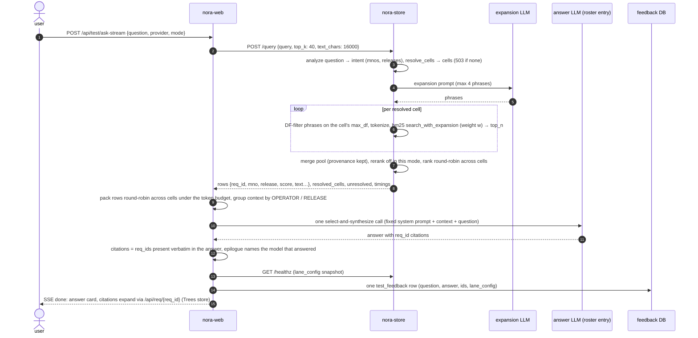

Data read: the in-memory composed index and corpus rows of each resolved
cell (Cells + Overlay); the query prompt loaded at startup; nothing from
Trees until a citation is expanded. The store should run with rerank
disabled in this mode; the pool is cut at top-k × cells when balanced
fusion is on.

### 22.2 The SIRA lane, rerank-pin mode

The default when `NORA_SIRA_SYNTH_MODE` is unset. Retrieval and rerank in
nora-store, a pin filter in nora-web, then the NORA synthesizer over the
pinned requirements. This mode needs the vector store for the pinned
chunk fetch, so it runs on dev stacks with `out/vectorstore` present.

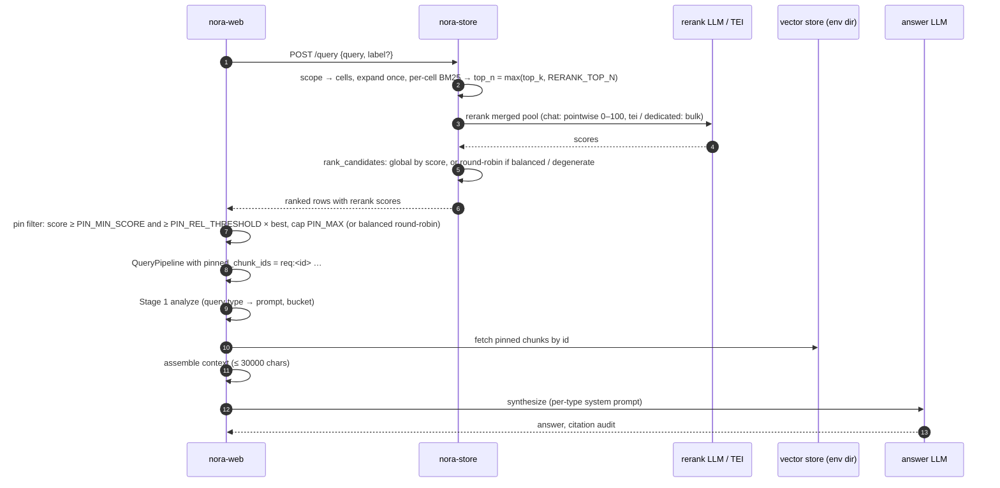

### 22.3 The NORA lane (admin, dev stacks)

Runs entirely inside nora-web over the env dir: analyze → resolve scope
(MNO and release, latest by default) → graph scope (bypassed without a
knowledge graph; a stub is built from vector-store metadata) → retrieve
per cell (dense Chroma + BM25, fused by RRF with the per-type weight,
optional cross-encoder rerank, glossary pin for acronyms) → distance
threshold → optional grouping (off by default) → assemble (graph parents,
standards sections, hierarchy path) → synthesize → citation audit. It
reads no nora-store data. It is the pre-SIRA path, kept for comparison on
the merged tab.

### 22.4 What the query pattern changes

Classification (`QueryType`, `core/src/query/schema.py`) runs in two
places: in nora-store to extract scope, and in the NORA synthesizer to
pick the prompt and the retrieval bucket. In the SIRA lane, retrieval
itself does not vary by type; scope and synthesis do.

| Pattern | QueryType | Scope resolved to | Retrieval (SIRA lane) | Synthesis |
|---|---|---|---|---|
| lookup in one plan | `single_doc` | the named MNO, its latest release unless one is named | BM25 per cell, identical for every type | narrow bucket (10); per-type prompt |
| list everything about a feature | `cross_doc`, `feature_level` | as above | same | broad bucket (25) |
| compare two MNOs | `cross_mno_comparison` | every named MNO at its own latest; balanced fusion keeps cells represented | per cell, then round-robin or scored merge | broad; context grouped by OPERATOR |
| what changed between releases | `release_diff` | the named releases of one MNO, two cells; a `<rel>` phrase is normalized to `MMMYYYY` | per cell; same `req_id` in two releases stays distinct (composite id) | broad; context grouped by RELEASE. (The History store answers this exactly; the Ask page does not read it yet, §27.) |
| a specific value or threshold | `fact` | as single_doc | same | narrow; distance threshold 0.4 in the NORA lane |
| explain or summarize | `summarize` | as single_doc | same | broad; grouping always skipped; threshold 0.7 in the NORA lane |
| standards comparison, traceability | `standards_comparison`, `traceability` | as single_doc | same | broad; standards context only when the standards stage ran |
| anything else | `general` | all MNOs at latest when none is named | same | narrow |

Scope rules (`core/src/store_service/scope.py`): named MNOs → those; none → all
ingested MNOs. No release → each MNO's own latest; `latest` → the same.
A named MNO with no cells, an unparseable release phrase, or a cell not
ingested goes into `unresolved`, which the page shows rather than
silently narrowing.

Two overrides sit on top of every pattern: a **label** on `/query`
retrieves from the Overlay view "main + label" (built lazily per cell),
which is how a reviewer previews their edits; and the **refusal
fallback** retries once on the roster's fallback endpoint when the
primary returns a permanent refusal, in both nora-web and nora-store.

## 23. Enrichment review

A domain expert corrects the language model's phrases for a requirement.
Edits go to the Overlay authority; Apply recomposes the cell; a new
release keeps the edit when the requirement's text is unchanged.

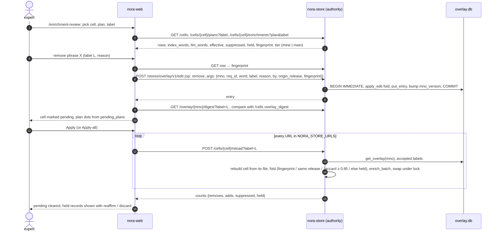

Points that matter:

- **Every edit is one HTTP op, run in the authority's transaction.** The
  web never read-modify-writes the Overlay. With no `NORA_OVERLAY_URL`,
  the same `overlay_ops` run on a local backend as a dev fallback.
- **Label = reviewer branch.** Records carry the label; the view "main +
  label" is what a labeled `/query` and a labeled reload use. `POST
  /labels/merge` (admin) flags the label accepted; records are not
  rewritten; a default-view Apply is still needed before serving changes.
- **Survival across releases** is the fold's job, not the reviewer's: a
  record applies to a new cell when its stamped `fingerprint` equals the
  requirement's `text_fp` there; otherwise same-release; otherwise the
  Jaccard guard; otherwise it is held and listed for reaffirm (restamp)
  or discard (delete).
- **Apply targets every stack** in `NORA_STORE_URLS`, so both A/B stacks
  recompose from the shared Overlay. Schema-1 cells answer 409.
- Exports: a review report (label × reason) and a prompt-fix scorecard
  that checks removed words against the latest release's phrases, both
  computed from the Overlay and the store's rows.

## 24. Golden evaluation

Two loops share the golden set: authoring samples in Eval Studio, and
running them against a stack to produce the number the gate records.

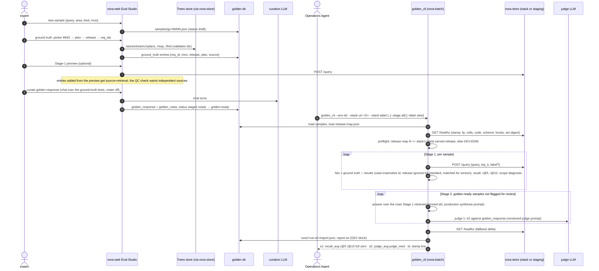

- **Sample kinds.** `standard` matches on (req_id, mno) and ignores
  release; `version` also matches the resolved release and may name
  releases relatively (`N`, `N-1`) through the release map. The map is
  advanced per MNO with `golden_release_cli advance`; a text check
  classifies each sample's entries (unchanged, title only, changed,
  absent) and flags samples for review, which Stage 2 skips until cleared
  in Eval Studio.
- **Reproducibility.** Stage 1 depends on the expansion phrases, which a
  language model produces, so repeated runs differ by about ±0.02 in
  `recall_avg`; a baseline is one full run plus three Stage-1 repeats,
  kept by hand per stack. The curation chat uses a fixed model, not the
  roster, so the golden response is reproducible.
- **Run id** = timestamp + stack label. It is the `--run-ref` of the
  gate. Nothing checks it against the run directory; it is provenance by
  convention.
- **No target values are coded.** The Operations Agent compares the block
  with the baseline and decides the verdict. §27 carries this.

## 25. Two stacks and the shared Overlay

Two compose projects on one host serve two release sets side by side: a
candidate next to production, or two language models over the same set.
They share the golden set and the feedback database by mount, and the
Overlay by HTTP.

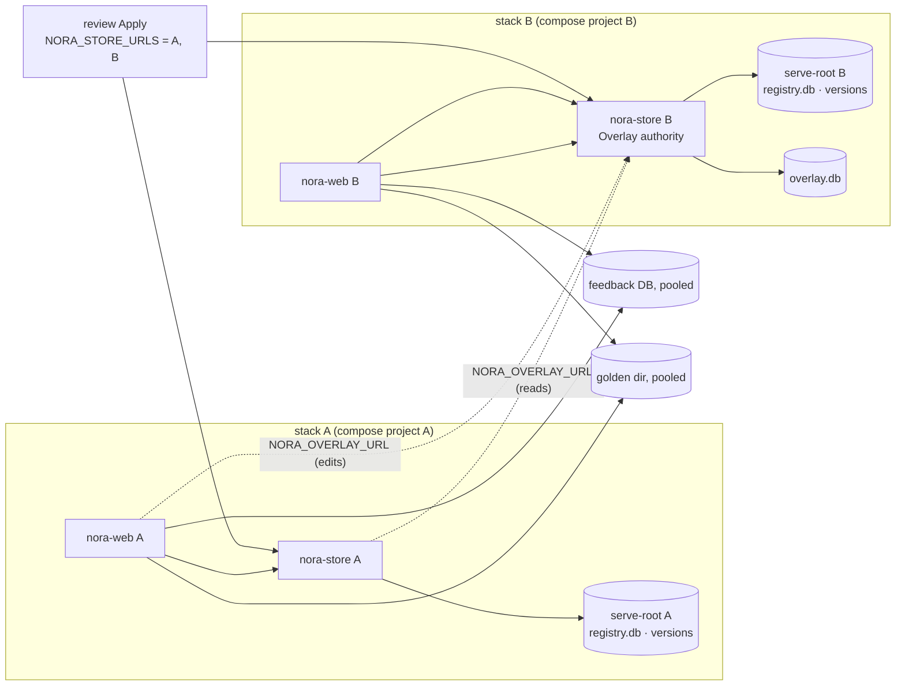

- **One authority.** Stack B's nora-store opens `overlay.db` read-write.
  Stack A's nora-store and both webs point `NORA_OVERLAY_URL` at it; A's
  store reads the Overlay at load and reload, A's web sends edits to it,
  and B's store refuses nothing because it is the authority. Writes to A's
  store would answer 409; nothing sends them.
- **Each stack has its own serving root and registry**, so the two can
  serve different sets, or the same label published into both roots. A
  release set is per root; the same label in two roots is two
  independent publishes with their own gate and flip.
- **Moving a stack to another set** is a flip in that stack's registry
  (§21 steps 5–6). Moving a stack *between* roots is a wiring-env change
  (`SERVE_REGISTRY_ROOT`) and a recreate of the services, since compose
  reads the env at create time, not on restart.
- **A/B evaluation** is two golden runs with different `--stack-url` and
  `--stack-label`, compared by their blocks. The stamp line carries each
  stack's fingerprint, code version, knobs digest and set digest, so a
  difference is attributable.
- **Hairpin.** A container cannot reach its own stack's published port
  through the host gateway; cross-stack URLs use the host gateway and the
  other stack's published port, same-stack URLs use the service name.

---

# Part V — Properties and boundaries

## 26. Invariants and where they are enforced

An invariant is listed only if some code enforces it or some test proves
it. "Enforced by" names the place a reader should look before changing
it.

| # | Invariant | Enforced by |
|---|---|---|
| I1 | Store files (Cells, Trees, History) are write-once. A new version is a new file; no process edits a published file. | converter and builders write temp + rename; publish stages into `.staging/` and renames; `publish gc` deletes files, never rewrites them; nora-store opens `mode=ro&immutable=1` |
| I2 | A release-set label never changes meaning. | `release_set.label` is the primary key; `publish publish` refuses an existing label (`PUB-E001`); members are inserted once and never updated |
| I3 | A release set is complete: every unit the stack serves. | `plan_release_set` inherits every untouched unit from the base set; warnings for a Trees unit without Cells and the reverse |
| I4 | After a flip, `active` equals exactly one set's members. | `Registry.flip` deletes and inserts in one transaction; `active_label` returns empty when rows disagree; `test_stores_publish` |
| I5 | No flip without a recorded gate verdict. | `Registry.gate_verdict` rule; `publish flip` refuses with `PUB-E004`; `--force` records a waived manual run before flipping |
| I6 | Rollback is always a pointer move to a set that served before. | `served_before` check (`PUB-E009`); `kind=rollback` flip; files are protected from GC for the last N flip targets |
| I7 | A stack never shows a mixed set. | `_registry_resolve` cached per load/reload; Cells, Trees, History and healthz read the one resolution; `publish flip --store-url` verifies `registry_versions` |
| I8 | Publish reuse keys on content and schema, never on release or build. | `find_version(store, unit, fingerprint, schema_version)`; History fingerprint = hash of Trees inputs |
| I9 | Version numbers assigned by one publish are its own. | `BEGIN IMMEDIATE` held across staging; readers `mode=ro` |
| I10 | The Overlay has one writer: the authority nora-store. | `overlay_router(writable)` answers 409 unless `is_overlay_authority`; `HttpOverlayStore(read_only)` raises; the compose file mounts the corrections dir rw only on nora-store |
| I11 | Edit semantics cannot drift between the web's local path and the authority's route. | both run `core/src/stores/overlay_ops`; parity tests per store (local vs HTTP) |
| I12 | Both Overlay backends return byte-identical entries, so digests are backend-independent. | `overlay_import` verifies equality per MNO inside one transaction (`OVL-E003`); backend parity tests |
| I13 | Cell files are a function of the build alone; the Overlay is never baked in (schema 2). | the converter stores vanilla blobs and raw phrases; the identity gate proves composed == baked; reload of a schema-1 cell answers 409 |
| I14 | Local and HTTP backends return equal results for every store protocol method. | parity tests in `core/tests/test_stores_*` and `core/src/store_service/test_stores_api.py` |
| I15 | An unsupported `schema_version` is refused, never migrated in place. | `SchemaVersionError` (`OVL-E005`, `TRS-E007`, `HIS-E006`), `REG-E003`; readers select columns by name and tolerate additive change |
| I16 | Trees `load_tree` reproduces the JSON tree exactly, key order and requirement order included. | `req_json` verbatim, `req_key_pos`; `trees_build` verify step compares against the file backend |
| I17 | History: a `version` row exists only when `node_fp`, `subtree_fp` or location changed; equal `subtree_fp` means nothing changed at or below the node except its own location. | `write_history_db`; `history_build` verify (self-diff of the latest release is empty) |
| I18 | nora-web holds no corpus data in a served deployment. | compose wires `NORA_{OVERLAY,TREES,HISTORY}_URL` and `NORA_STORE_URL` to nora-store; `/api/health` reports each store's kind |
| I19 | Every new web route is gated. | `team_mode.py` allowlist; the branch-flow rule requires a test with the gate on |
| I20 | No requirement text, words or reasons in logs, error messages, CLI output or compact blocks. | builders and publish print counts and identities; error codes carry remedies only; the feedback DB is the one runtime store that holds content, by design |
| I21 | Services never recreate themselves from a restart; configuration applies on recreate. | compose `environment:` and env files are read at create; runbooks say recreate, not restart |
| I22 | Healthz identity is computed once per load, not per request. | `_compute_identity` at load and reload; `data_fingerprint_cells` from the cell DBs' `meta` |

## 27. Known gaps and deferred work

By plane. Each item says what is true today, so a reader does not infer
the opposite from the design.

### Build plane

- **The build is not incremental across cycles.** `cycle.sh start` makes
  an empty env dir; `parse` runs every cell; the SIRA db-root is per
  build, so every cell is re-enriched. The ingestion guide says a new
  release re-parses and re-enriches only that cell; that holds only
  inside one build. Two steps would make it true: seed `out/parse` and
  the previous build's SIRA cells, and run the lane with `--only` the
  new cell. `sira_incremental` already has `prune` and `commit` for
  changed documents; nothing calls them.
- **Standards is skipped by habit, not by configuration.** It runs in the
  ingestion lane unless `--skip-standards` is passed; it needs the
  network. `config/llm.json` has no `skip_standards`.
- **The flat promote does not carry cell DBs** (`cell-dbs/` is not
  linked). Served stacks do not need them, since publish converts from
  the flat cells; the lane's `--index cell-db` output is for dev.
- **Taxonomy seeding is manual** (copy the previous `out/taxonomy`).

### Publish plane

- **Remote transfer.** `LocalTransfer` only; a remote `Transfer`
  (rsync, upload) is the first task of the corp deployment strand.
- **Registry backend.** SQLite; Postgres is a deployment decision, the
  schema is portable.
- **`run_ref` is free text.** The gate records what the Operations Agent
  types; nothing links it to `runs/<run-id>/`.
- **No target values.** Acceptance is a human comparison against a
  baseline file kept by hand per stack; NFR-15 speaks of per-release
  targets that the code does not hold.
- **GC of orphan files** is reported, not done.

### Serve plane

- **Serving mode default.** FR-40 names select-synth as the serving path;
  the code default with `NORA_SIRA_SYNTH_MODE` unset is rerank-pin, which
  needs the vector store. One of the two should move.
- **History has no consumer.** The store is published and served on
  every stack; nothing in nora-web reads it; release-diff questions are
  answered by retrieval over two cells. Validation of the change
  classification against real releases, and a consumer surface, are a
  separate strand.
- **No `CellStore` protocol (TODO).** Cells is the one store without a
  protocol, local backend, HTTP client and router; the service's
  `/cells*` routes and `cell_db_store.py` stand in. Retrieval does not
  need it; the package boundary and nora-web's corpus reads would be
  cleaner with it (`core/src/stores/MODULE.md` → Deferred).
- **Expansion is not reproducible.** Stage-1 recall moves by about ±0.02
  between runs because the expansion phrases come from a language model;
  an expansion-off or replay mode for evaluation is not implemented.
- **Pre-sidecar labels lack fingerprints.** Cells converted from a label
  that predates the fingerprint sidecar have empty `corpus.fingerprint`
  and `fingerprint_version`; the Overlay fold falls back to same-release
  and Jaccard for them.
- **Disabled labels** are stored and reported but not applied by the
  fold, and no UI sets them.
- **Runtime DBs and the golden set** are nora-web's own files on mounted
  volumes. Moving them behind nora-store (jobs, metrics, config,
  feedback, samples, runs) is deferred; the Overlay was the first store
  to make that move.
- **The query analyzer's `llm` arm reports as `rules`** in served paths
  because no served caller passes a provider; the `decision` arm is the
  one that makes a network call.

### Documents

The procedures and the System Design Document that still describe
labels plus env repoint as the serve path, or JSON files as the
corrections authority, are listed with line references in the strand's
journal and are being updated after this document lands.

## 28. Glossary

| Term | Meaning |
|---|---|
| **active** | the registry rows that say which version of each unit a stack serves; always one set's members after a flip |
| **authority (Overlay)** | the nora-store whose Overlay backend is opened read-write; the only writer |
| **cell** | one MNO at one release: `<mno>__<rel>`; the unit of retrieval, of Cells and Trees |
| **Cells store** | per-cell SQLite with corpus rows, raw SIRA phrases and the vanilla index blobs (schema 2) |
| **composition** | folding the Overlay onto a cell's SIRA phrases at load, then enriching the in-memory index |
| **effective set** | the phrases that reach the index for one requirement after the fold |
| **env dir** | one build's directory tree: inputs, `out/<stage>/`, reports, prompts |
| **expansion** | the phrases a language model adds to a question before BM25; weighted by `expansion_weight`; DF-filtered per cell |
| **fingerprint** | a content hash: `text_fp` (requirement text), `node_fp`, `subtree_fp`, `child_set_fp` (History), `source_fingerprint` (a store file's inputs) |
| **flat label** | `serve/<label>/`: the hard-linked snapshot of a build's parse trees and SIRA cells; the converter's input |
| **flip** | the transaction that makes a release set the active one; `rollback` is a flip to an earlier set |
| **fold** | the per-requirement rule deciding which Overlay records apply (fingerprint, same release, Jaccard, else held) |
| **gate** | a recorded verdict (`gate_run`) for a release set; the latest per kind decides |
| **held** | an Overlay record the fold could not confirm for the current release; shown for reaffirm or discard |
| **History store** | per-MNO SQLite of release lineage: version intervals, content by `text_fp`, change kinds |
| **label (Overlay)** | a reviewer's branch on edit records; the view is "main + label" |
| **label (release set)** | the name of one publish; also the flat label directory name |
| **lane** | one retrieval-and-answer path on the Ask page: SIRA (serving) or NORA (dev) |
| **Overlay** | the store of expert enrichment edits: remove, add, suppress per requirement |
| **pin filter** | in rerank-pin mode, the score thresholds that choose which retrieved requirements reach the synthesizer |
| **publish** | the CLI and the plane that turn a flat label into versioned store files and a release set |
| **registry** | `registry.db`: store versions, release sets, gate runs, active, flips; one per serving root |
| **release set** | a label naming one version of every unit a stack serves |
| **rerank** | a second scoring of the retrieved pool by a language model or a TEI server, pointwise or bulk |
| **scope** | the cells a question concerns, resolved from the MNOs and releases it names |
| **serving root** | the directory a stack mounts read-only: `registry.db` plus `cells/`, `trees/`, `history/` |
| **SIRA** | the enrichment and retrieval method: a BM25 index over requirement text enriched with language-model phrases; also the name of the upstream code the images carry |
| **stack** | one nora-web plus one nora-store, one compose project, one serving root |
| **staging store** | a nora-store started with `NORA_STORE_RELEASE_SET=<label>` to serve a staged set for the gate |
| **Trees store** | per-cell SQLite of the parsed requirement tree with path-based traversal |
| **unit** | what publish versions: a cell (Cells, Trees) or an MNO (History) |
| **vanilla index** | the BM25 index SIRA built from the corpus alone, before phrases and before the Overlay |
| **view digest** | sha256 of the Overlay records visible in a label view; compared between the authority and what a cell loaded to show "pending" |
