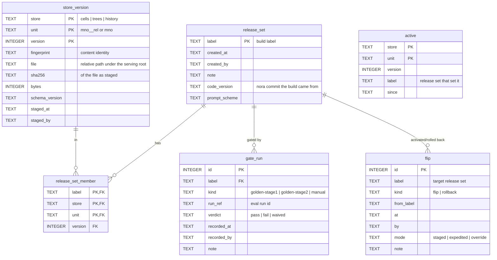
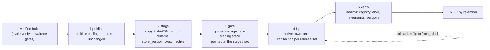

# Publish pipeline — phase 4b (v1.2, 2026-10-24)

Strand `corp-db-layer`. Replaces `storage-design.md` §5a and refines
`store-split-design.md` §7 for the four-store layout. Reviewed and
agreed 2026-10-23 (§8 questions 1–3 as drafted). v1.1: B1–B7 built
(`core/src/stores/registry.py`, `publish.py`; nora-store registry mode);
§9 records where the build refined the design, B8 (trial end-to-end)
passed, and the roll-out: since 2026-10-23 every nora stack serves from
its own registry (§9.11).

## 1. What 4b is for

Today a release reaches serving by `promote.sh` (hardlink snapshot of a
build into `serve/<label>/` with a `MANIFEST.json`), `serve-push.sh`
(copy to another host) and `serve-flip.sh` (rewrite a stack's env
pointers, recreate, verify healthz). The unit is a whole label; identity is
the label name plus the data fingerprint; the gate is a human "yes" with an
optional eval-run reference; rollback is a flip to the previous label.

4b keeps every one of those properties and changes the unit and the
pointer: the unit becomes a **store version per cell** (Cells, Trees) or
per MNO (History), and the pointer becomes a row in a registry rather
than a path in an env file. A release then pushes only the units that
changed, serving can be flipped and rolled back per release in one
transaction, and the history of what served when is a table rather than
`PROMOTE_LOG` lines. The registry path is the serve path for every nora
stack since 2026-10-23; `promote.sh` / `serve-flip.sh` remain for
dev/test-only stacks and the label directories remain the converter's
flat input.

## 2. Units, versions, identity

| Store | Unit | File | Version identity |
|---|---|---|---|
| Cells | (MNO, release) | `cells/cell-<mno>-<rel>-v<N>.db` | `source_fingerprint` (corpus + phrases) |
| Trees | (MNO, release) | `trees/trees-<mno>-<rel>-v<N>.db` | `source_fingerprint` (tree files) |
| History | MNO | `history/history-<mno>-v<N>.db` | hash of the input Trees versions |

- `N` is a per-unit counter assigned by the registry; the content hash,
  not `N`, says whether two versions are the same data.
- **Idempotent:** publishing a unit whose fingerprint already has a
  version records nothing new and reuses that version (B1 "skips
  unchanged").
- The Overlay is never published (it is deployment state); the registry
  does not know it.
- A **release set** is the tuple of unit versions a publish produces, named
  `<label>` (the same build label as today, so eval stamps and logs line
  up with current practice).

## 3. The registry (`registry.db`, SQLite, one per serving root)

- `active` is the only row set serving reads at start. Everything else is
  provenance.
- Postgres-portable (TEXT/INTEGER only). Mutable, so it follows the
  Overlay's rule: SQLite on a single host; Postgres in corp if the
  deployment facts call for it (store-split-design §9.4).

## 4. The pipeline

**1. Publish** — `python -m core.src.stores.publish --label <label> --build <build-dir> --serve-root <root> [--cells …] [--dry-run]`
- Builds or takes the units: Cells via the converter (pinned run, overlay
  folded for the identity gate only), Trees via `trees_build`, History via
  `history_build` over the Trees versions in the set.
- Computes each unit's fingerprint; a unit whose fingerprint already has a
  `store_version` row is **reused** (no file written). Output: the release
  set's member list with new/reused per unit.
- Deterministic: the same build yields the same fingerprints; the counts
  and fingerprints go to the compact report, never content.

**2. Stage** — for each new unit: copy to `<root>/<store>/.staging/<file>`,
verify sha256, rename into place, insert `store_version`; then
`release_set` and its members. A failure leaves no partial unit visible
(temp + rename, same posture as `serve-push.sh`). **Transfer is a
pluggable step**: local copy now (`LocalTransfer`); a remote transfer
(rsync/scp or an upload endpoint, storage-design §8.3) implements the same
two calls, `put(file) -> sha256` and `exists(file)`.

**3. Gate** — a staging stack (nora-store started with
`NORA_STORE_REGISTRY=<root>/registry.db --release-set <label>`, i.e. the
staged set instead of `active`) is evaluated by the golden runner over
HTTP, unchanged. The run id is recorded as a `gate_run` row with its
verdict against the stack's baseline (the comparison `serve-flip.sh`'s
`--mode staged` asks for today). `kind=manual, verdict=waived` records
an expedited flip with a note, as `--mode override` does today.

**4. Flip** — `publish flip --label <label> [--mode …] [--yes]`: refuses
unless the set has a passing (or waived) `gate_run`; writes every
`active` row of the set and one `flip` row in **one transaction**; the
previous active rows are recoverable from the previous set's members.
`publish rollback --to <label>` is the same transaction with
`kind=rollback`. Serving picks the change up on its next start or on
`POST /registry/reload` (below).

**5. Verify** — healthz on the serving store reports `registry_label`,
the per-unit versions and fingerprints; the flip command compares them
with the registry and fails loudly on a mismatch (today's step 5).

**6. GC** — `publish gc --keep N`: delete `store_version` files that are
neither active nor in the last N release sets nor referenced by a
`gate_run` newer than the retention window; rows stay (provenance), files
go.

## 5. Serving from the registry (B6)

- `NORA_STORE_REGISTRY=<root>/registry.db` makes nora-store resolve its
  cell DBs, Trees root and History root from `active` instead of
  `NORA_STORE_ROOT` / `NORA_TREES_ROOT` / `NORA_HISTORY_ROOT`. Those three
  stay for registry-less stacks (dev).
- `--release-set <label>` (env `NORA_STORE_RELEASE_SET`) serves a staged
  set for the gate without touching `active`.
- `POST /registry/reload` re-reads `active`, loads changed units, swaps
  them in and recomposes the Overlay for changed cells (the same per-cell
  swap Apply uses). Unchanged units are not reloaded.
- Healthz adds `registry_label`, `registry_versions` (store/unit → version,
  fingerprint). The golden `StackStamp` keeps keying on
  `data_fingerprint`; `registry_label` is attribution, as `serve_label` is.
- Read-only: nora-store never writes the registry.

## 6. Mapping to today

| Today | 4b |
|---|---|
| `serve/<label>/` hardlink snapshot | `store_version` files + `release_set` |
| `MANIFEST.json` | `release_set` row (+ members) |
| `serve-flip.sh` rewriting `NORA_ENV_DIR` / `STORE_ROOT` | `active` rows |
| `PROMOTE_LOG` | `flip` table |
| `--mode staged / expedited / override`, `--eval-run` | `gate_run` kinds and verdicts, `flip.mode` |
| rollback = flip to the previous label | `publish rollback --to <label>` |
| `serve-push.sh` | the transfer step |

All three served stacks adopted the registry path on 2026-10-23 (§9.11).
The old path remains for dev/test-only stacks.

## 7. Test plan

- Unit: fingerprint idempotence (publish twice → no new rows/files); a
  failed stage leaves no visible unit; flip refused without a gate; flip
  and rollback are atomic (a crash between rows is not observable: one
  transaction); GC keeps active + N + gated.
- Integration (no bm25x): registry resolution in `open_*` factories;
  `--release-set` vs `active`; `/registry/reload` swaps only changed
  units; healthz fields.
- **B8 on trial:** publish trial's label into a stand-in serving root →
  stage → gate (golden Stage-1, expansion off for determinism) → flip →
  healthz verification → rollback → verification. Counts only in the
  report.

## 8. Decisions taken at review (2026-10-23)

1. The release-set name is the build `<label>` (continuity with eval
   stamps and logs).
2. A release set may mix a new Cells version with a reused Trees version
   for the same cell; History is rebuilt whenever any Trees member changes.
3. The gate records both an expansion-off Stage-1 (deterministic) and an
   expansion-on run (quality).
4. The runtime DBs (jobs, metrics, config, feedback) and golden samples
   stay out of 4b (storage-design §8.2).

## 9. Refinements made while building (v1.1)

1. **Reuse keys on fingerprint + schema version** (§2): the same source
   converted by a newer cell-DB schema is new content for serving. History
   keys on a hash of its Trees members' fingerprints (any schema), so the
   reuse decision precedes the build.
2. **A release set is always complete** (§2): a publish that rebuilds a
   subset (`--cells`, one store) inherits every other unit from a base set
   (`--base`, default the active set). A flip then replaces `active`
   wholesale, and a rollback is exactly the previous set.
3. **Gate rule** (§4.3): the latest run per kind decides that kind; a set
   may flip when at least one kind passed or was waived and no kind's
   latest run failed. `--force --reason` records a `manual / waived` run
   and flips in `override` mode; it never bypasses the log.
4. **Registry write lock across staging** (§4.2): the publisher assigns
   version numbers (and file names) inside one `BEGIN IMMEDIATE`, stages,
   then commits; a failure rolls back and removes the staged files.
   Readers (`mode=ro`) are never blocked.
5. **`store_version.removed_at`** (§3): GC marks a version's file removed;
   rows stay. `gc --keep N` protects the active set, the last N sets and
   the targets of the last N flips (a rollback target stays restorable);
   files no row knows are reported, not deleted.
6. **Serving resolves once** (§5): nora-store reads the registry at cell
   load and on `POST /registry/reload`; Cells, Trees, History and healthz
   all use that one resolution, so a flip in progress never shows a mixed
   set. `NORA_TREES_ROOT` / `NORA_HISTORY_ROOT`, when set, still win for
   their store (same precedence as the `open_*` factories).
7. **Verify step is part of flip** (§4.5): `publish flip --store-url`
   posts the reload, then requires healthz `registry_label` and
   `registry_versions` to equal the set; a mismatch exits non-zero with
   the rollback command (the registry already points at the set).
8. **Transport**: `publish gate` records a run; running the golden eval
   against the staging stack stays the runner's job (unchanged over HTTP).
9. **Pre-flip start** (B8 field finding): a store started in registry
   mode with no active set is multi-cell with 0 cells — it loads its
   prompts at start and never takes the legacy single-dataset path; the
   first `/registry/reload` loads the prompts if an older image skipped
   them and clears the startup error fields. `code_version` on a release
   set comes from `NORA_CODE_VERSION` (image-baked) before git.
10. **B8 on trial, 2026-10-23: passed.** 13 units published, gate and
    flipped store both 0 of 39 differ against the 4a run, rollback drill
    2 sets / 3 flips, GC dry-run 0 removed; the label directory was
    never written.
11. **Roll-out, 2026-10-23.** Each stack got its own serving root and
    registry (one `active` per registry, so one root per stack): the
    A/B pair followed trial with the same publish → gate → flip round,
    each at 0 of 39 differ and 0 knob values changed. The Overlay
    authority and trial moved onto the SQLite Overlay in the same
    rounds (`overlay_import` in a throwaway batch container, then
    `NORA_OVERLAY_DB`; D-DRAFT-34). Two field findings fixed on the way:
    a store started before its first flip now loads its prompts and the
    reload repairs an older image; an unopened Trees/History store
    reports no change on reload. Stale label pointers were retired from
    the wiring envs with 0 healthz keys changed. Retirement of the env
    backups, the pre-4a image sets and the label directories waits for
    a soak; the flat cell inputs stay until the next build cycle.
12. **Not in this strand:** the remote `Transfer` and the first corp
    publish (4c), and the registry's corp backend. The runtime DBs and
    golden samples stay nora-web's files (a separate strand).
