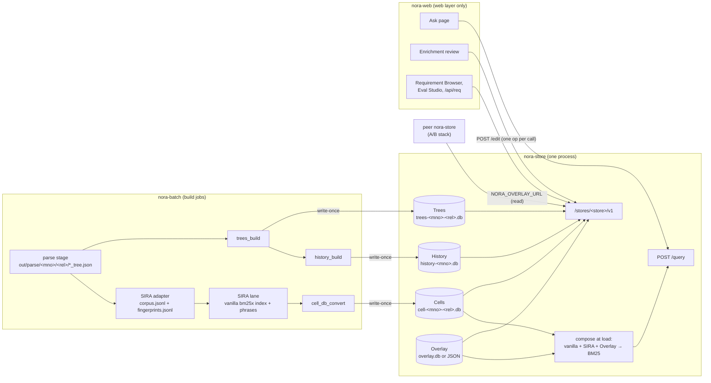
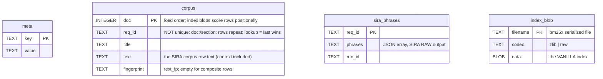
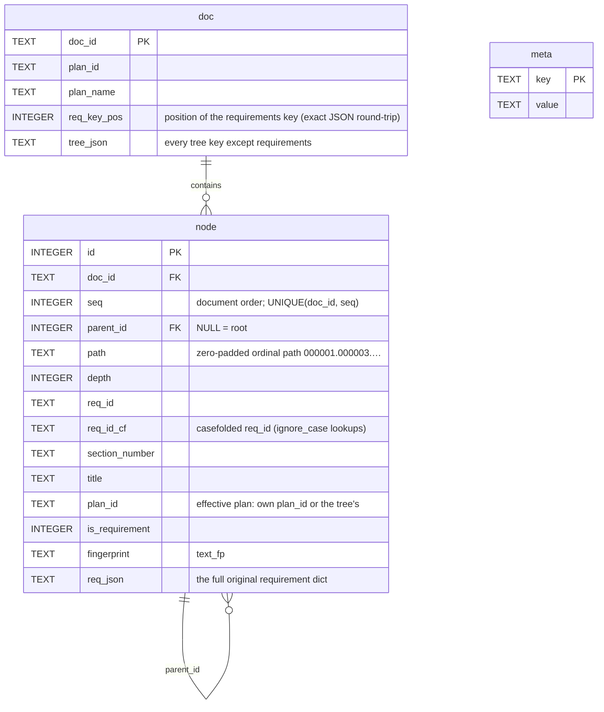
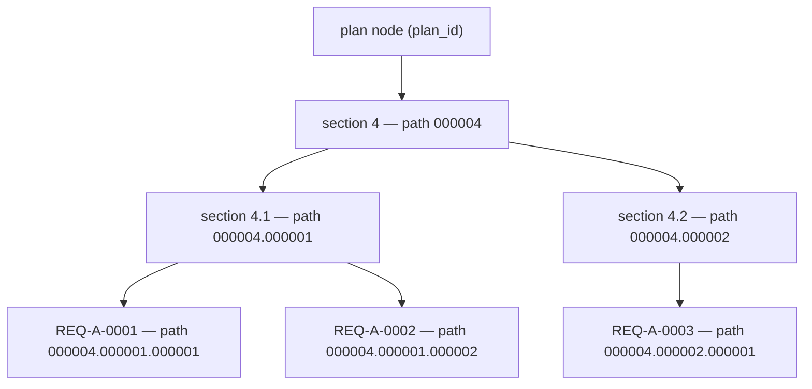
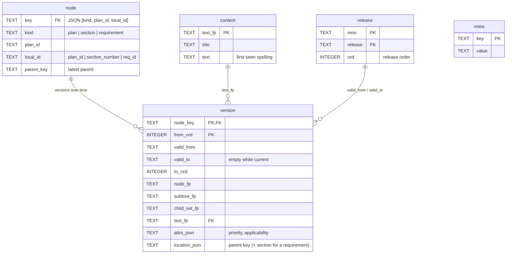
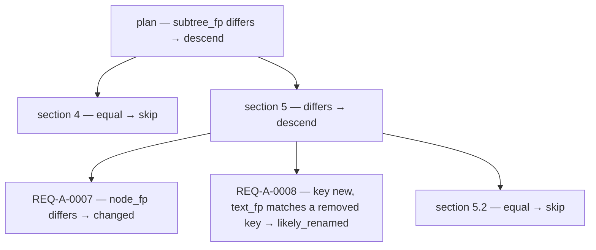
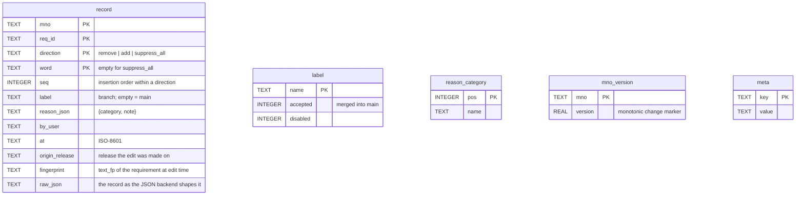

# Store schemas — the four persistent corpus stores

Strand `corp-db-layer` · 2026-10-22 · taken from the DDL in the code (branch
`store-split`). Design rationale lives in `store-split-design.md`; this file
is the reference for *what is stored where*, with diagrams.

## 1. The picture



- **Write-once:** Cells, Trees, History. A new version is a new file; a
  rebuild is the migration.
- **Mutable:** Overlay only. One writer: the nora-store that hosts it (the
  *authority*). nora-web sends edits over HTTP; a peer store reads it over
  HTTP.
- nora-web keeps no corpus data. Its file backends exist only as a dev
  fallback when the `NORA_<STORE>_URL` variables are unset.

## 2. Fingerprints (the join keys)

All values are `v2:<sha256 hex>`; the prefix is the canonical-form version.

| Hash | Over | Stored in |
|---|---|---|
| `text_fp` | canonical title + body (tables inline) | Cells `corpus.fingerprint`, Trees `node.fingerprint`, Overlay `record.fingerprint`, History `version.text_fp` |
| `node_fp` | `text_fp` + priority + applicability | History only |
| `subtree_fp` | `node_fp` + one entry per child in document order: (child key, child location, child `subtree_fp`) | History only |
| `child_set_fp` | the same child entries, sorted | History only (reorder detection) |

Canonical form v2: Unicode NFKC, quotes/dashes/bullets unified, case fold,
whitespace collapsed. Location is excluded, so a move is a location change,
not a content change. `text_fp` says the requirement's own content is the
same; it does not certify SIRA enrichment (phrases come from the full corpus
row).

## 3. Cells — retrieval

One SQLite file per (MNO, release): `cell-<mno>-<release>.db`, schema 2.
Built by `sandbox/cell_db_convert.py` from the SIRA flat build. Read by
nora-store at start; the index is composed in memory (§7).



- Index: `corpus(req_id)`.
- `meta` keys: `schema_version` (2), `converter_version`, `cell_mno`,
  `cell_release`, `source_label`, `source_fingerprint` (identity of the
  served data: sha256 over `corpus.jsonl` + the phrase file), `enrich_run`,
  `enrich_model`, `sira_docs`, `fingerprinted_docs`, `fingerprint_version`
  (empty when the label predates the adapter sidecar), `n_docs`,
  `bm25x_max_n`, `bm25x_ngrams`, `index_files`, `created_at`.
- **Not stored:** effective (post-overlay) phrases, review edits, an
  enriched index. Schema 1 (baked enriched index, `enrichment` table) is
  still loadable; it cannot take review edits.
- HTTP (`/stores/cells/v1`): `GET /cells`, `GET /cells/{mno}/{release}/meta`,
  `/rows?req_id=`, `/phrases?req_id=`, `/effective?req_id=&label=`. No
  index blobs over HTTP: the index is consumed in-process by `POST /query`.

## 4. Trees — parsed requirement trees

One SQLite file per (MNO, release): `trees-<mno>-<release>.db`, schema 1.
Built by `core.src.stores.trees_build` from `out/parse/<mno>/<release>/*_tree.json`.
The file backend over `out/parse` is the default; `NORA_TREES_ROOT` selects
SQLite.



- Indexes: `req_id`, `req_id_cf`, `fingerprint`, `plan_id`, `(doc_id, path)`, `parent_id`.
- Hierarchy = `parent_req_id` from the tree. Subtree = range scan on
  `path`; ancestors = path prefixes. A repeated id in one document: the
  last copy is the addressable node.
- `meta` keys: `schema_version` (1), `fingerprint_version`, `mno`,
  `release`, `cell`, `n_docs`, `n_nodes`, `source_fingerprint` (sha256 over
  the tree files' names and bytes), `created_at`.
- **New parse-tree fields need no schema change:** they ride in `req_json`
  / `tree_json`. A field becomes a column only when queried or indexed.
- HTTP (`/stores/trees/v1`): `/cells`, `/docs`, `/tree`, `/plans`, `/find`,
  `/reqs`, `/node`, `/children`, `/subtree`, `/ancestors`, `/fingerprint`.



## 5. History — release lineage per MNO

One SQLite file per MNO: `history-<mno>.db`, schema 1. Built by
`core.src.stores.history_build` from the Trees store across the MNO's
releases, in release order. Derived data: rebuilt, never edited.
`NORA_HISTORY_ROOT` selects it.



- Indexes: unique `(kind, plan_id, local_id)`, `plan_id`, `(to_ord, from_ord)`.
- **A `version` row exists only when something changed**: a new `node_fp`,
  `subtree_fp` or location. Identical text across versions is stored once
  in `content`.
- **Identity across releases:** plan → `plan_id`; section →
  `(plan_id, section_number)`; requirement → `(plan_id, req_id)`, its
  section kept in `location_json`. A renumbered section is removed + added
  (tagged *likely renamed* when its `text_fp` matches); a requirement that
  moves keeps its key and records a new location.
- Change kinds between two releases: `added`, `removed`, `changed`
  (`node_fp`), `moved` (location), `reordered` (`child_set_fp` equal,
  `subtree_fp` different), `likely_renamed` (tag on an added/removed pair).
- `meta` keys: `schema_version` (1), `fingerprint_version`, `mno`,
  `releases`, counts, `source` (the cells' tree source fingerprints),
  `created_at`.
- HTTP (`/stores/history/v1`): `/mnos`, `/releases`, `/req`, `/plan`,
  `/req/last-changed`, `/plan/last-changed`, `/diff`, `/latest`.

How intervals read, for one requirement across four releases:

```mermaid
gantt
  title version rows for one requirement (REL-1 … REL-4)
  dateFormat X
  axisFormat %s
  section REQ-A-0001
  v1 node_fp=a, section 4.1      :done, 1, 3
  v2 node_fp=b (text changed)    :active, 3, 4
  v3 node_fp=b, section 4.2 (moved) :5, 4, 5
```



Three rows, not four: REL-1 and REL-2 share the first row (`valid_from`
REL-1, `valid_to` REL-2). "Last changed" = REL-3 (new `node_fp`); the
move at REL-4 is a location change and does not count.

A plan's `subtree_fp` descends only into changed branches:



## 6. Overlay — review edits (the only mutable store)

Per deployment. Backends: the JSON file layout (today's default,
`<corrections>/sira-enrich/{<MNO>.json, accepted-labels.json, labels.json,
reason-categories.json}`) or SQLite (`NORA_OVERLAY_DB`). Both return
byte-identical entries, so digests do not depend on the backend. Written
only by the authority nora-store, through `POST /stores/overlay/v1/edit`;
read by nora-store for composition (§7) and by nora-web for the review UI.



- Index: `record(label)`.
- One active record per (requirement, direction, word): re-editing a word
  replaces its record. Records are never rewritten by a merge; merging a
  label = flagging it `accepted`, so provenance survives.
- **When an edit applies to a release** (the fold, same code in server and
  local paths): its `fingerprint` equals the requirement's current
  `text_fp` → applies; else same release as `origin_release` → applies;
  else token-set Jaccard against the origin ≥ 0.85 → applies; otherwise
  **held** for re-affirmation.
- `view_digest(mno, label)`: sha256 of the records visible in a label view;
  nora-web compares it with the digest nora-store served to show "pending".
- HTTP (`/stores/overlay/v1`): GET `/mnos`, `/overlay/{mno}`,
  `/overlay/{mno}/entry`, `/overlay/{mno}/version`, `/overlay/{mno}/digest`,
  `/labels/accepted`, `/labels/disabled`, `/reasons`; PUT
  `/overlay/{mno}/entry`, `/labels/accepted`, `/labels/disabled`,
  `/reasons`; POST `/edit` (`{"op": …, "args": {…}}`, one op per call,
  run inside the store's transaction). A non-authority answers 409 on writes.

## 7. How a query is served (composition)

```mermaid
sequenceDiagram
  participant S as nora-store (start)
  participant C as Cells
  participant O as Overlay (local or NORA_OVERLAY_URL)
  participant Q as POST /query
  S->>C: load vanilla index + sira_phrases + fingerprints
  S->>O: get_overlay(mno), accepted labels
  S->>S: per req: effective = suppress_all ? adds : (SIRA − removes) + adds<br/>(fingerprint / same-release / Jaccard guard; else held)
  S->>S: enrich_batch(effective) → serving index (memory)
  Q->>S: question
  S-->>Q: scope → BM25 per cell → merge → rank
  Note over S,O: review Apply = reload one cell: re-read Cells + Overlay, recompose, swap
```

Measured 2026-10-22: 1.4 s to compose 5 cells (40k rows); no cache (D-DRAFT-23).

## 8. Configuration

| Variable | On | Meaning |
|---|---|---|
| `NORA_STORE_ROOT`, `NORA_STORE_INDEX=cell-db`, `NORA_STORE_ENGINE=bm25x` | nora-store | where the cell DBs are; serving mode |
| `NORA_STORE_CORRECTIONS_ROOT` / `NORA_OVERLAY_DB` | nora-store (authority) | Overlay backend: JSON root or SQLite file |
| `NORA_OVERLAY_URL` | peer nora-store | read a shared Overlay from the authority; writes refused |
| `NORA_ENV_DIR`, `NORA_TREES_ROOT`, `NORA_HISTORY_ROOT` | nora-store | Trees (file or SQLite) and History roots |
| `NORA_OVERLAY_URL`, `NORA_TREES_URL`, `NORA_HISTORY_URL` | nora-web | use the store over HTTP (default `http://nora-store:8040`); unset = local file fallback |
| `NORA_STORE_URL(S)` | nora-web | retrieval and Apply targets |

To host a store on its own: `python -m core.src.stores.serve --stores trees,history,overlay --port PORT`
and set that store's URL on every consumer. Cells stays with `POST /query`
(the index lives in that process).

## 9. Versioning and change

- Every DB carries `schema_version` in `meta`; readers refuse an unsupported
  version: TRS-E007 / HIS-E006 / OVL-E005 (`SchemaVersionError`); the Cells
  reader raises `CellDbError` naming the schema (the CNV- codes belong to
  the converter).
- Additive changes (new column with a default, table, meta key, JSON or
  response field) do not bump the version; readers tolerate absence.
- Cells, Trees and History are rebuilt per publish, so a rebuild is the
  migration. Overlay gets in-place migrations when its schema first changes.
- HTTP routes are versioned in the path (`/v1`).
- Error-code families: `CNV-` (converter), `TRS-` (Trees), `HIS-` (History),
  `OVL-` (Overlay).
