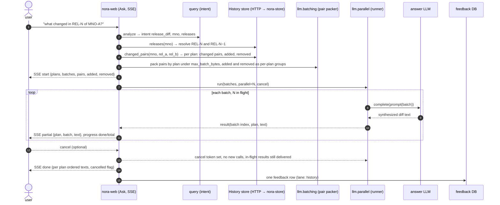

# Release history — validation and the synthesized release diff

Strand `rel-history` · design v0.1 · 2026-10-25 · phase: architecture.
Builds on `docs/architecture.md` §15 (History store), §22 (serving a
question), D-279 (three hashes, History as a Merkle tree), D-280
(nora-store hosts every store).

## 1. What this strand delivers

1. **Validation.** The History store's change classification is checked
   against two consecutive releases of one MNO on a served stack, and
   corrected where the documents disagree with it.
2. **A consumer.** Release-change questions on the Ask page are answered
   from the History store: the changed requirements' previous and current
   texts go to the language model side by side, in size-bounded batches
   sent as parallel calls; the answer streams in, grouped by plan, with
   progress and cancel.
3. **A general capability.** The batch packer and the parallel runner
   live in `llm`, independent of the release diff, so summaries and
   cross-MNO comparisons can use them later.

Out of scope: changes to retrieval; History for more than one MNO per
question; a History page outside the Ask flow (noted as a later option
in §9).

## 2. Part one — validation

### 2.1 Procedure

1. Pick one MNO with two consecutive served releases, REL-A (older) and
   REL-B (newer), on a stack whose History unit covers both.
2. Run the diff from the served store, counts only:
   `GET /stores/history/v1/diff?mno=<mno>&rel_a=<REL-A>&rel_b=<REL-B>`.
   Record: counts per change kind overall and per plan; the ten most
   changed sections; the number of `likely_renamed` pairs.
3. Run the same call with `diffs=true` on the host only (it carries
   requirement text) and read the change rows against the two documents
   for a sample: every `likely_renamed` pair, every `moved`, every
   `reordered`, and ten `changed` rows chosen across plans.
4. For each sampled row, one verdict: correct, wrong kind, false
   positive, missed (a change the documents show and the store does
   not). Missed changes are found by reading two plans' section lists
   side by side and checking that every difference appears in `changes`.
5. Each wrong verdict becomes a case in `core/tests/test_stores_history*.py`
   built from synthetic trees that reproduce the shape, then a fix in
   `core/src/stores/history.py` (`release_nodes`, the identity rules,
   the change-kind derivation) or in `models/fingerprint.py` if the
   canonical form is at fault. The store is rebuilt by publishing a new
   set; the registry reuses the unchanged Trees units and rebuilds only
   History.

Shared output of this part: the counts table and the verdict table with
kinds and section numbers, no requirement text.

### 2.2 What is likely to need correction

Known soft spots from the design (architecture §15):

- Section identity is `(plan_id, section_number)`: a renumbered section
  is removed + added, tagged `likely_renamed` only when its `text_fp`
  matches exactly. A renumbered section whose title changed by one word
  will show as removed + added with no tag. Candidate fix: a second
  rename signal on `subtree_fp` of the children, or a title-similarity
  guard like the Overlay's.
- `moved` fires on any location change, including a requirement whose
  parent section was renumbered. The requirement did not move; its
  section's number did. Candidate fix: report `moved` only when the
  parent's `likely_renamed` partner does not explain it.
- `reordered` requires equal `child_set_fp` and different `subtree_fp`.
  A reorder plus one changed child shows as `subtree` on the parent and
  `changed` on the child, with the reorder itself invisible. Acceptable
  or not is a verdict for the reader.

## 3. Part two — the synthesized release diff

### 3.1 Flow



### 3.2 Where each piece lives

| Piece | Module | Why there |
|---|---|---|
| `changed_pairs(mno, rel_a, rel_b)` | `stores` (HistoryStore protocol, SQLite backend, HTTP client, router route `/stores/history/v1/pairs`) | one call returns everything the packer needs; it is a read over existing tables (`version`, `content`), so it belongs beside `diff_releases` |
| pair packer | `llm/batching.py` | pure, stdlib; knows nothing about History |
| parallel runner | `llm/parallel.py` | provider-neutral, calls `LLMProvider.complete` per batch; progress and cancel |
| release-diff prompt and grouping | `query/release_diff.py` | the query layer owns prompts and intent handling; it builds the batches' prompts and reassembles per plan |
| Ask route and SSE events | `web/routes/playground.py` | the page already streams lanes over SSE |

### 3.3 `HistoryStore.changed_pairs` (as built)

```
changed_pairs(mno, rel_a, rel_b) -> {
  "mno": str, "from": rel_a, "to": rel_b,
  "plans": {
    plan_id: {
      "plan_name": str, "present": {"from": bool, "to": bool},
      "changed":    [ {req_id, section, old: {title, text, priority, applicability}, new: {...}, kinds: [..]} ],
      "added":      [ {req_id, section, title, text, priority, applicability} ],
      "removed":    [ ... same shape ... ],
      "renamed":    [ {kind: requirement | section, old_id, new_id, section} ],
      "renumbered": [ {req_id, section, from, detail} ],
      "moved":      [ {req_id, section, from} ]
    }
  },
  "absent_plans": {plan_id: {absent_in: rel}},
  "counts": {changed, added, removed, renamed, renumbered, moved, plans, absent_plans}
}
```

- `changed` = requirement rows whose `node_fp` differs (text, priority or
  applicability); `kinds` lists any location kind that came with it. A
  pure `renumbered` or `moved` requirement is not a pair.
- The removed half of a rename pair appears only under `renamed`.
- Texts come from `content` by `text_fp`; `old` is the node state at
  `rel_a`, `new` at `rel_b`; attributes from the version's `attrs_json`.
- Deterministic order: plans by `plan_id`, rows by outline position
  (numeric components compare as numbers), then id.
- Over HTTP: `GET /stores/history/v1/pairs?mno&rel_a&rel_b`, one call;
  the payload carries requirement text and is for the web layer.

### 3.4 Pair packer (`llm/batching.py`)

```
pack(items, size_of, max_bytes=32768, group_key=None) -> list[Batch]
Batch = {index, group, items, bytes}
```

- Never splits an item. An item larger than `max_bytes` gets its own
  batch and `oversized=True`; the caller decides (the release diff sends
  it anyway with a note, since a single requirement pair is rarely over
  the limit).
- `group_key` keeps a batch within one group (here: one plan), so every
  batch's output belongs to one plan and reassembly is a sort.
- `size_of` is the caller's byte estimate of the prompt contribution of
  one item (old + new text + framing); the packer adds a fixed per-batch
  overhead the caller passes in.
- Pure function, stdlib, deterministic.

### 3.5 Parallel runner (`llm/parallel.py`)

```
run(batches, call, parallel=4, cancel=None, on_result=None) -> RunResult
RunResult = {results: {index: text | error}, done, total, cancelled, elapsed_ms, calls}
```

- `call(batch) -> str` is the caller's closure around
  `provider.complete(...)`, so the runner never sees prompts or
  providers. The provider is constructed per question (reasoning effort
  is a construction-time choice, `llm` invariant), outside the runner.
- `parallel` is the number of batches in flight; a thread pool, since
  `complete()` is synchronous and the providers use blocking HTTP.
- `cancel` is a `threading.Event`. When set: no new batch starts;
  batches in flight finish and deliver; `cancelled=True` in the result.
- `on_result(index, text_or_error)` fires as each batch completes, in
  completion order; the web turns it into SSE events.
- A failed batch is recorded as an error for that index and does not
  stop the run; the refusal fallback runs inside `call` as today
  (`maybe_wrap_with_refusal_fallback`).
- No retries beyond the fallback, no rate limiting: the module's
  non-goals stand. `parallel` is the throttle.

### 3.6 Prompts (`query/release_diff.py`)

Three prompt shapes, one per batch kind, each returning plain text with
requirement ids verbatim so the bubbles work:

- **Changed batch**: for each pair, old and new title and text side by
  side; instruction: for each requirement, state what changed in one or
  two sentences, cite the id, do not restate unchanged text; priority or
  applicability changes named as such.
- **Removed group** (one per plan, batched by size like the rest): the
  list of removed requirements with their text; instruction: name the
  removed ids, then one short summary of what the plan lost as a whole.
  One removed requirement gets one sentence.
- **Added group**: the same shape for additions.

The per-plan `moved` and `renamed` lists are not sent to the model; the
reassembly step prints them as one line each ("Section 4.2 renumbered to
4.3; 3 requirements moved with it").

### 3.7 Reassembly and display

- Output grouped by plan in `plan_id` order; within a plan: changed
  batches in batch order, then removed, then added, then the moved and
  renamed lines.
- Each partial arrives with `(plan, batch index)`; the page inserts it
  into its plan's slot, so the display fills in plan by plan while
  later batches are still running.
- Progress: `done / total` batches, plus per plan.
- Cancel: the page's button posts to a cancel route keyed by the
  question's run id; the SSE `done` event carries `cancelled=true` and
  the plans completed so far. A cancelled answer is still stored in the
  feedback DB, marked cancelled, so a shared link shows what was seen.
- Citations: every requirement id in the answer is a bubble through the
  existing `/api/req/{req_id}` path; ids of removed requirements resolve
  against REL-A, so the bubble request carries the release.

### 3.8 Configuration

| Variable | Default | Meaning |
|---|---|---|
| `NORA_HISTORY_DIFF_MAX_BATCH_BYTES` | 32768 | packer budget per batch |
| `NORA_HISTORY_DIFF_PARALLEL` | 4 | batches in flight |
| `NORA_HISTORY_DIFF_ENABLED` | on when `NORA_HISTORY_URL` is set | the Ask page routes `release_diff` intents here when the stack serves History for the MNO; otherwise the SIRA lane answers as today |

All three resolve through the unified chain (CLI, env, config DB,
`config/*.json`, default) like the other query knobs (D-050).

### 3.9 Error codes

New family `RHD-` (release history diff), registered in
`core/src/pipeline/error_codes.py`:

| Code | Meaning |
|---|---|
| RHD-E001 | the MNO has fewer than two served releases |
| RHD-E002 | the named release is not served |
| RHD-E003 | History not configured on this stack (`NORA_HISTORY_URL` unset or `stores.history=off`) |
| RHD-E004 | a batch failed after the fallback (recorded per batch, the run continues) |
| RHD-I001 | run cancelled by the user after N of M batches |

Compact block for the page's engineering details and the feedback row:
`RHD mno=<mno> from=<rel> to=<rel> plans=N pairs=N added=N removed=N
batches=N parallel=N bytes_max=N done=N cancelled=0|1 elapsed_ms=N`.
No requirement text.

## 4. Query intent

`QueryType.release_diff` exists and is detected by two release mentions
or delta, diff, changed phrasing. Two additions:

- Relative releases: "REL-N", "latest", "the new release" resolve
  through `HistoryStore.releases(mno)`: latest and the one before. The
  golden eval's relative-release vocabulary (`N`, `N-1`) is reused.
- One MNO per question in this strand. A question naming two MNOs with
  "changed" stays `cross_mno_comparison` and takes the retrieval path.

## 5. Decisions to draft

1. `changed_pairs` as a History protocol method (soft flag: additive)
   rather than composing `diff_releases` and `req_history` client-side.
2. The runner in `llm` with a per-batch closure, the Protocol unchanged.
3. Deleted and added requirements summarized per plan, not paired.
4. Cancel semantics: in-flight batches complete and are shown.
5. Routing: `release_diff` to History when served, else retrieval.

## 6. Tests

- `stores`: `changed_pairs` parity local vs HTTP; deterministic order;
  renamed pairs excluded from `changed`; a pure move not a pair.
- `llm`: packer never splits, respects the budget, groups; runner
  honors `parallel`, delivers in completion order, cancel stops new
  starts, a failing batch does not stop the run.
- `query`: prompt builders produce the three shapes; reassembly orders
  by plan and batch; moved and renamed lines rendered.
- `web`: SSE event sequence for a two-plan, three-batch run with a
  cancel after the first result; gate-on test for the cancel route;
  the engineering block carries no text.

## 7. Roll-out

1. Validation on a served stack (§2); fixes published as a new History
   version through the registry.
2. Stores and llm changes, tests, MODULE.md updates.
3. Query and web, behind `NORA_HISTORY_DIFF_ENABLED`; dev stack first.
4. Golden eval: a `version`-kind sample per MNO with a release-change
   question, scored on Stage 2 only (Stage-1 recall does not apply to a
   History answer).

## 8. Open questions

- Should `changed_pairs` include `diff` word-level markup for the model,
  or let the model find the difference? Start without; measure.
- Batch size by bytes or by estimated tokens? Bytes first (the knob the
  summary asked for); the enrichment batcher's chars-per-token estimate
  is available if tokens prove necessary.
- Cancel propagation to the provider: `complete()` is one-shot and
  blocking; an in-flight call runs to completion. Acceptable at the
  default parallelism; revisit if calls are long.

## 9. Later options, not this strand

- A History page in nora-web: plan timeline, last-changed per
  requirement, diff between any two releases, from the same store calls.
- Summaries and cross-MNO comparisons on the runner.
- Multi-MNO release questions.
